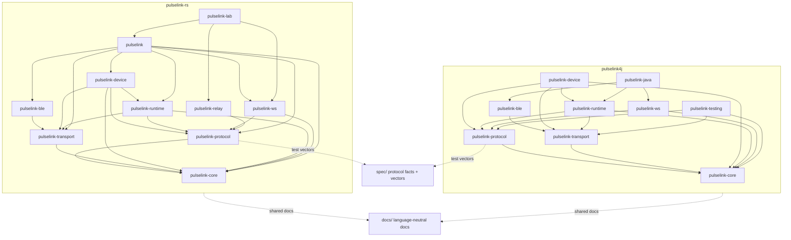

# Architecture

`pulselink` is a multi-language SDK for DG-LAB devices. Rust and JVM share protocol facts and test
vectors, but each implementation follows its language's idioms and build system.

## Repository graph

## Boundaries

- `pulselink-core` is synchronous domain state; no I/O.
- `pulselink-protocol` is sans-io; no BLE, WebSocket, or runtime dependencies.
- `pulselink-transport` is the local-device port; platform backends implement it.
- `pulselink-ble` is a platform adapter. Rust uses btleplug; JVM uses Kable.
- `pulselink-device` owns device profiles and local device sessions.
- `pulselink-runtime` owns Coyote V3 session behavior, ACK, scheduler, safety, and reconnect.
- `pulselink-ws` owns DG-LAB V4 WebSocket RPC, multi-app state, and remote operations.
- `pulselink` (Rust) and `pulselink-java` (JVM) are composition/facade layers only.
- `pulselink-relay`, `pulselink-lab`, and `pulselink-testing` are non-published development tools.

## Shared specification

`spec/` is the canonical source for protocol behavior and test vectors. Implementations may keep
test-only copies for their build system, but CI must verify those copies match `spec/`.

## Language-specific references

- Rust architecture: [`pulselink-rs/docs/architecture.md`](../pulselink-rs/docs/architecture.md)
- JVM roadmap: [`pulselink4j/ROADMAP.md`](../pulselink4j/ROADMAP.md)
- JVM build/nullness notes: [`pulselink4j/docs/`](../pulselink4j/docs/)
