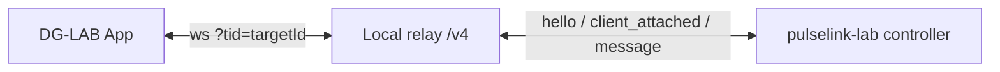

# Local WebSocket relay

`pulselink-relay` is a non-published local Rust relay for testing the DG-LAB V4 controller protocol
with a real DG-LAB app. JVM controllers can connect to the same relay with `pulselink-ws`. It replaces the lab's old
`MockRelay`-backed fake app.

## Topology



## Run

Standalone:

```bash
cargo run -p pulselink-relay -- --bind 0.0.0.0:8787
cargo run -p pulselink-relay -- --bind 0.0.0.0:8787 --public-url wss://relay.example
```

Through the lab:

```text
ws local
```

`ws local` starts the relay on `0.0.0.0:8787`, connects a controller, and logs:

```text
local relay listening: ws://192.168.1.10:8787/v4
V4 target id: <target>
pairing URL: ws://192.168.1.10:8787/v4?tid=<target>
QR URL: https://dungeon-lab.cn/s/?v=1&action=socket&url=<encoded>
```

Open the pairing URL or QR URL in the DG-LAB app on the same LAN.

`relay start [addr]` starts the relay without connecting a controller.
`relay stop` and `relay status` manage it.

## Protocol behavior

- Controller connects without `tid`; the relay returns `hello { clientId }`.
- App connects with `?tid=<targetId>`.
- Controller receives `client_attached { clientId }`.
- App receives `controller_attached { clientId: targetId }`.
- Controller-to-app messages must contain `clientId`; the relay routes them.
- App-to-controller messages get a `clientId` added by the relay.
- App disconnect sends `client_disconnected` to the controller.
- Controller disconnect sends `controller_disconnected` and close `4000` to apps.
- Heartbeat is sent every 30 seconds.
- `ping` receives `pong { ts }`.
- An unpaired controller is closed with `idle_timeout` and `4002` after the configured timeout.
- Invalid `tid` closes the app with `4001`.
- Too many apps closes the new app with `1013`.

## Security and TLS

The relay has no authentication or TLS and binds to the LAN by default. The target id is a pairing
secret; do not publish it.

Plain `ws://` is intended for trusted local development. Some DG-LAB app versions may require
`wss://` or a trusted certificate. If the app rejects a local `ws://` URL, put the relay behind a
TLS tunnel or reverse proxy and use
`--public-url wss://...`.

## Limitations

- No audio, waveform visualization, or cloud relay replacement.
- No persistence; target ids and app registrations are per controller connection.
- No automatic reconnect; create a new controller and pair the app again.
