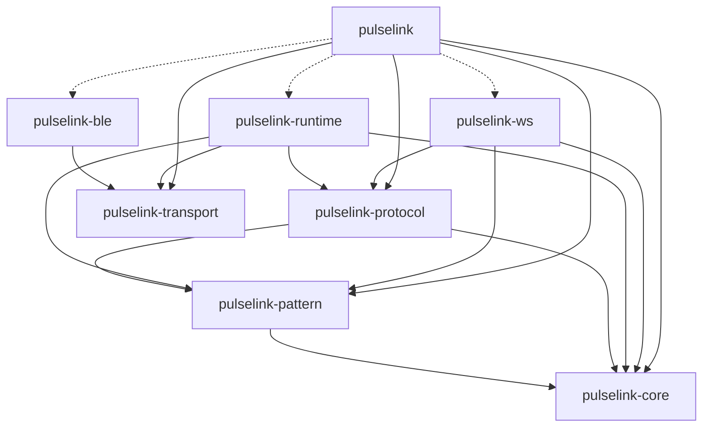
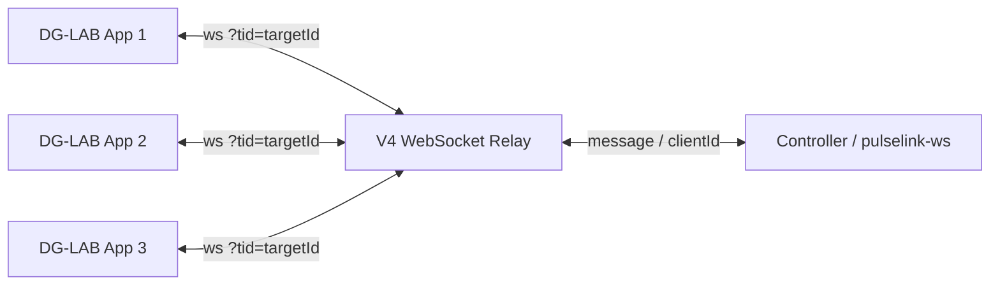
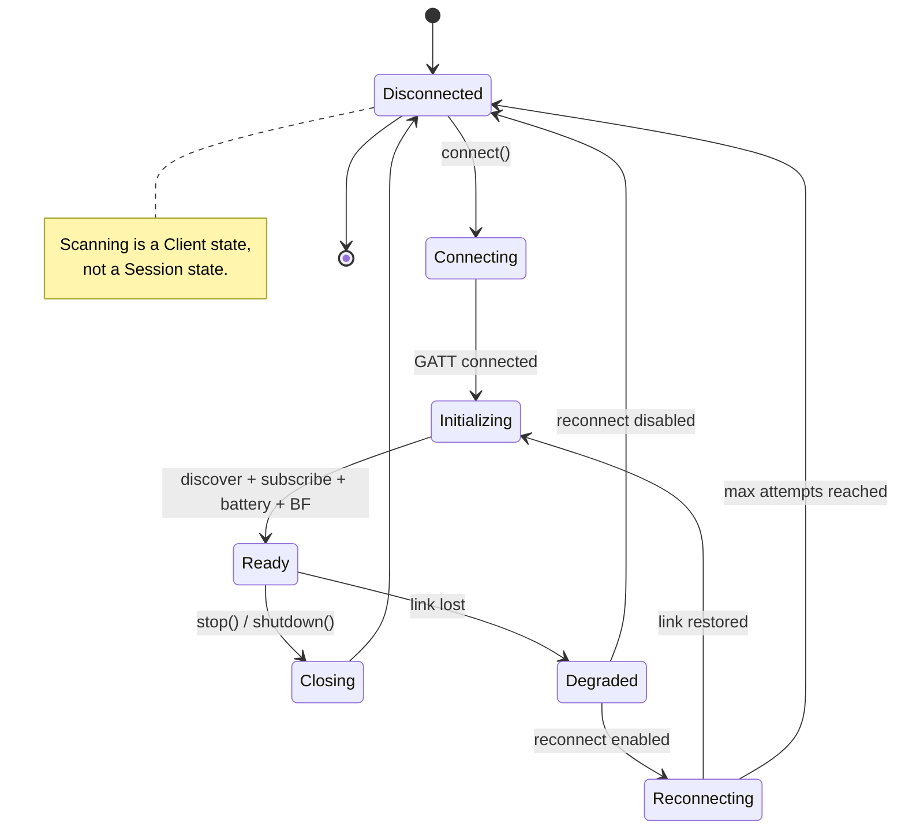
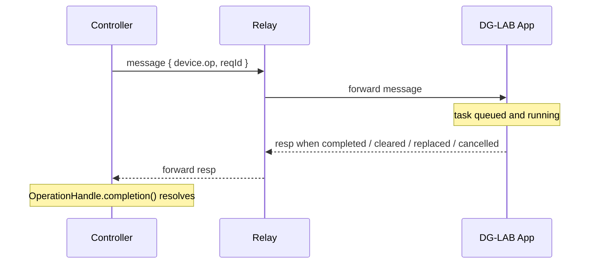

# pulselink-rs Implementation Roadmap

> Status: Confirmed implementation roadmap.
>
> Target version: `pulselink 0.1.0`
>
> Implementation status:
>
> - [x] M0 — Workspace Foundation
> - [x] M1 — Core + Pattern
> - [x] M2 — Protocol
> - [x] M3 — Transport
> - [x] M4 — BLE Backend
> - [x] M5 — WebSocket Transport / RPC
> - [x] M6 — BLE Runtime
> - [x] M7 — WebSocket Session
> - [x] M8 — Facade
> - [ ] M9 — Hardening & Release
>
> Scope: Coyote V3 BLE + DG-LAB V4 WebSocket.
>
> Out of scope for 0.1: Coyote V2 BLE, V3 WebSocket, PawPrints/Civet/Opossum drivers, audio
> analysis, waveform visualization, CLI, FFI, first-class Android/iOS support.

---

## 0. Purpose of This Document

This is not an "architecture essay"; it is an executable construction plan for
`pulselink-rs` from an empty repository to `0.1.0`. It defines:

1. Each crate's responsibilities, boundaries, dependency direction, and public API;
2. Each module's file layout and key types;
3. Precise contracts for protocol codecs, Session runtime, ACK, scheduling, safety, and
   reconnection;
4. Test vectors, mocks, real hardware, CI, release, and acceptance criteria;
5. A dependency-ordered task list (M0–M9), where every task has a concrete deliverable and
   completion condition.

If implementation discovers a conflict between this document and the real protocol or the Rust
ecosystem, update this document first, then change the code. Do not bypass the contracts with a
"write it first, figure it out later"
approach.

---

## 1. Project Positioning

### 1.1 Goals

`pulselink-rs` is the Rust workspace for `pulselink`, a reliable, async-first, testable, and
extensible DG-LAB device-control SDK:

- **Connectivity**: BLE scanning, connection, GATT discovery, Notify subscription, disconnection,
  and reconnection;
- **Protocol**: Coyote V3 BLE codecs; DG-LAB V4 WebSocket frames and RPC;
- **Control**: channel intensity, soft limits, balance parameters, waveform playback, and stop;
- **Execution**: Session Actor, command queue, Sequence/ACK, 100 ms scheduling, safety policy, and
  lifecycle;
- **Remote**: V4 multi-app, device discovery, remote device operations, and task completion
  semantics;
- **Ergonomics**: most users only depend on `pulselink`; advanced users can use
  protocol/transport/ble/ws directly.

### 1.2 Non-Goals (Not in 0.1)

- Full Coyote V2 BLE support;
- Legacy V3 WebSocket protocol;
- PawPrints, Civet, and Opossum device drivers;
- Audio-to-waveform conversion, HWL files, and waveform visualization;
- GUI, QR code rendering, and CLI;
- C ABI, WASM, and FFI;
- First-class Android/iOS support (only transport extension points are kept);
- A universal "DeviceManager" or a cross-device unified control trait;
- Automatically restoring active output after a disconnect;
- ACK timeouts, retries, and connection management inside the protocol layer.

### 1.3 Success Criteria

When `pulselink 0.1.0` is complete, it should satisfy:

1. A user can add only `pulselink = "0.1"`, enable `ble`, and scan, connect to, and safely control a
   Coyote V3;
2. A user can add only `pulselink = "0.1"`, enable `websocket`, and complete V4 pairing, multi-app
   handling, device discovery, intensity, and waveform operations;
3. `pulselink-protocol` can be published and used independently, without Tokio, btleplug, or
   WebSocket;
4. `pulselink-transport` can be implemented by third parties (custom BLE backends), and the runtime
   does not depend on btleplug;
5. Mock GATT + paused time cover ACK timeout, late B1, disconnection, reconnection, scheduler lag,
   and other exceptional scenarios;
6. Windows/Linux/macOS compile; at least one platform is validated with a real Coyote V3;
7. All feature combinations pass CI; `cargo publish --workspace --dry-run`
   passes;
8. There is no `unsafe`; library code has no panic paths caused by
   `unwrap()`/`expect()`;
9. Documentation, rustdoc, examples, CHANGELOG, and LICENSE are complete.

---

## 2. Decisions (ADR Summary)

| ID  | Decision                                                                                               | Rationale                                                                                                                |
|-----|--------------------------------------------------------------------------------------------------------|--------------------------------------------------------------------------------------------------------------------------|
| D1  | Use a virtual Cargo workspace; the facade lives at `crates/pulselink`                                  | A workspace is not a publish unit; the facade needs its own package name `pulselink`                                     |
| D2  | Use eight crates: core, pattern, protocol, transport, ble, runtime, ws, pulselink                      | Each crate has an independent responsibility and dependency direction; avoids a single-crate mud ball and over-splitting |
| D3  | `pulselink-transport` exists from day one                                                              | Transport is a port the runtime explicitly needs, not speculation; avoids the runtime depending backwards on ble         |
| D4  | `pulselink-runtime` depends only on transport, not btleplug                                            | A high-level runtime should not depend on a platform adapter; enables mocks and third-party backends                     |
| D5  | `pulselink-ble` is an adapter that implements transport traits                                         | btleplug is isolated inside the adapter; replacing the backend does not affect protocol                                  |
| D6  | `pulselink-protocol` is sans-io                                                                        | Pure codecs and validation; no Tokio/btleplug/WebSocket                                                                  |
| D7  | `pulselink-pattern` is separate but minimal                                                            | Semantic waveform is separated from wire encoding; V3 semantics first, V2 can be a lossy compiler later                  |
| D8  | `pulselink-ws` is fully independent of BLE/runtime                                                     | V4 task-completion semantics differ; WS-only builds must not compile BLE                                                 |
| D9  | First version implements only a concrete `CoyoteV3Session`; no generic DeviceDriver trait              | With one device, a driver abstraction becomes a god trait; extract it after a second device lands                        |
| D10 | Auto-reconnect is enabled by default, but never automatically resumes a Pattern/output                 | The user confirmed default-on; safety requires explicit output resumption                                                |
| D11 | Default feature is `ble`; `websocket` is opt-in; `full` enables both                                   | Keeps default builds lean; WS users can depend on `pulselink-ws` only                                                    |
| D12 | Rust 2024, `resolver = "3"`, `rust-version = "1.99"`                                                   | Current stable; a new project does not need to carry an old MSRV                                                         |
| D13 | License remains Apache-2.0                                                                             | User confirmed; btleplug's MIT/Apache-2.0/BSD-3-Clause is compatible                                                     |
| D14 | All library crates are released together at the same version; `integration-tests` is `publish = false` | Cargo publishes per crate; the facade's dependencies must resolve from crates.io                                         |
| D15 | Platform priority: Windows/Linux/macOS; Android/iOS later                                              | btleplug supports them; desktop reliability comes first                                                                  |
| D16 | Share `spec/` test vectors and protocol semantics with pulselink4j, not directory structure            | Rust and JVM follow their own language conventions; protocol facts stay consistent                                       |
| D17 | Do not copy official protocol documents verbatim; `spec/` contains summaries, links, and test vectors  | Official documents have commercial-use restrictions; avoid copyright issues                                              |
| D18 | V4 reconnect does not silently reuse the old targetId                                                  | The server assigns a new clientId per connection; the app must re-pair                                                   |

---

## 3. Overall Architecture

### 3.1 Crate Dependency Graph



Dependency rules:

- Arrows point downward only: core/pattern/protocol/transport never depend on a higher layer.
- `pulselink-transport` does not depend on core/protocol/pattern, and does not depend on Tokio. It
  is an independent local-device link SPI.
- `pulselink-runtime` does not depend on `pulselink-ble`; it uses a backend via
  `Arc<dyn Backend>`.
- `pulselink-ws` does not depend on transport/runtime/ble; it has its own message transport and RPC
  lifecycle.
- `pulselink` only performs composition, default backend injection, curated re-exports, and unified
  errors; it contains no second business logic.

### 3.2 Directory Layout

```text
pulselink-rs/
├── Cargo.toml                      # virtual workspace
├── Cargo.lock
├── rust-toolchain.toml
├── rustfmt.toml
├── deny.toml
├── LICENSE
├── README.md
├── CHANGELOG.md
├── crates/
│   ├── pulselink-core/
│   │   ├── Cargo.toml
│   │   ├── README.md
│   │   └── src/
│   │       ├── lib.rs
│   │       ├── id.rs
│   │       ├── device.rs
│   │       ├── capability.rs
│   │       ├── channel.rs
│   │       ├── intensity.rs
│   │       ├── state.rs
│   │       ├── event.rs
│   │       └── error.rs
│   ├── pulselink-pattern/
│   │   ├── Cargo.toml
│   │   ├── README.md
│   │   └── src/
│   │       ├── lib.rs
│   │       ├── sample.rs
│   │       ├── frame.rs
│   │       ├── timeline.rs
│   │       ├── pattern.rs
│   │       └── error.rs
│   ├── pulselink-protocol/
│   │   ├── Cargo.toml
│   │   ├── README.md
│   │   ├── src/
│   │   │   ├── lib.rs
│   │   │   ├── error.rs
│   │   │   ├── coyote/
│   │   │   │   ├── mod.rs
│   │   │   │   └── v3/
│   │   │   │       ├── mod.rs
│   │   │   │       ├── gatt.rs
│   │   │   │       ├── b0.rs
│   │   │   │       ├── bf.rs
│   │   │   │       ├── b1.rs
│   │   │   │       ├── battery.rs
│   │   │   │       ├── frequency.rs
│   │   │   │       └── waveform.rs
│   │   │   └── socket/
│   │   │       ├── mod.rs
│   │   │       └── v4/
│   │   │           ├── mod.rs
│   │   │           ├── frame.rs
│   │   │           ├── rpc.rs
│   │   │           ├── device.rs
│   │   │           ├── operation.rs
│   │   │           └── event.rs
│   │   └── tests/
│   │       ├── vectors.rs
│   │       ├── b0.rs
│   │       ├── bf.rs
│   │       ├── b1.rs
│   │       └── socket_v4.rs
│   ├── pulselink-transport/
│   │   ├── Cargo.toml
│   │   ├── README.md
│   │   └── src/
│   │       ├── lib.rs
│   │       ├── link.rs
│   │       ├── central.rs
│   │       ├── error.rs
│   │       └── mock.rs
│   ├── pulselink-ble/
│   │   ├── Cargo.toml
│   │   ├── README.md
│   │   └── src/
│   │       ├── lib.rs
│   │       ├── central.rs
│   │       ├── link.rs
│   │       ├── scan.rs
│   │       ├── gatt.rs
│   │       ├── notify.rs
│   │       └── error.rs
│   ├── pulselink-runtime/
│   │   ├── Cargo.toml
│   │   ├── README.md
│   │   └── src/
│   │       ├── lib.rs
│   │       ├── client.rs
│   │       ├── session/
│   │       │   ├── mod.rs
│   │       │   ├── actor.rs
│   │       │   ├── command.rs
│   │       │   ├── event.rs
│   │       │   ├── state.rs
│   │       │   └── lifecycle.rs
│   │       ├── devices/
│   │       │   ├── mod.rs
│   │       │   └── coyote_v3/
│   │       │       ├── mod.rs
│   │       │       ├── driver.rs
│   │       │       ├── init.rs
│   │       │       ├── state.rs
│   │       │       └── config.rs
│   │       ├── sequence.rs
│   │       ├── ack.rs
│   │       ├── scheduler.rs
│   │       ├── player.rs
│   │       ├── safety.rs
│   │       ├── reconnect.rs
│   │       └── error.rs
│   ├── pulselink-ws/
│   │   ├── Cargo.toml
│   │   ├── README.md
│   │   └── src/
│   │       ├── lib.rs
│   │       ├── socket.rs
│   │       ├── app.rs
│   │       ├── device.rs
│   │       ├── operation.rs
│   │       ├── rpc.rs
│   │       ├── registry.rs
│   │       ├── transport.rs
│   │       └── error.rs
│   └── pulselink/
│       ├── Cargo.toml
│       ├── README.md
│       ├── examples/
│       │   ├── ble_scan.rs
│       │   ├── coyote_v3_control.rs
│       │   ├── ws_pairing.rs
│       │   ├── ws_control.rs
│       │   └── protocol_only.rs
│       └── src/
│           ├── lib.rs
│           ├── client.rs
│           └── error.rs
├── integration-tests/
│   ├── Cargo.toml                  # publish = false
│   └── tests/
│       ├── mock_ble.rs
│       ├── session.rs
│       ├── reconnect.rs
│       ├── ws_relay.rs
│       └── hardware.rs             # #[ignore] + env gate
└── docs/
    ├── architecture.md
    ├── coyote-v3.md
    ├── websocket-v4.md
    ├── runtime-contracts.md
    ├── testing.md
    ├── platforms.md
    └── ROADMAP.md                  # final location of this file
```

`spec/` lives at the repository root and is shared with `pulselink4j`:

```text
spec/
├── protocols/
│   ├── coyote-v3/
│   │   ├── gatt.md
│   │   ├── b0.md
│   │   ├── bf.md
│   │   ├── b1.md
│   │   └── waveform.md
│   └── websocket-v4/
│       ├── frames.md
│       ├── rpc.md
│       └── device-op.md
└── test-vectors/
    ├── coyote-v3/
    │   ├── b0.json
    │   ├── bf.json
    │   ├── b1.json
    │   ├── battery.json
    │   ├── frequency.json
    │   └── invalid.json
    └── websocket-v4/
        ├── frames.json
        ├── rpc.json
        ├── device-op.json
        ├── events.json
        └── invalid.json
```

### 3.3 Feature Matrix

| Feature     | Crate                                 | Purpose                                                                      |
|-------------|---------------------------------------|------------------------------------------------------------------------------|
| `ble`       | `pulselink`                           | Enables `pulselink-ble` + `pulselink-runtime` + btleplug backend             |
| `websocket` | `pulselink`                           | Enables `pulselink-ws` + `pulselink-protocol/socket-v4`                      |
| `full`      | `pulselink`                           | `ble` + `websocket`                                                          |
| `coyote-v3` | `pulselink-protocol`                  | Enables Coyote V3 BLE codecs (default)                                       |
| `socket-v4` | `pulselink-protocol`                  | Enables V4 JSON/RPC types (requires serde/serde_json)                        |
| `serde`     | `pulselink-core`, `pulselink-pattern` | Optional serialization support                                               |
| `mock`      | `pulselink-transport`                 | MockLink/MockCentral/MockConnector                                           |
| `btleplug`  | `pulselink-ble`                       | Enables the btleplug backend by default; when off, only adapter types remain |
| `test-util` | `pulselink-ws`                        | Internal WebSocket transport mock                                            |

Recommended usage:

```toml
# Default BLE user
pulselink = "0.1"

# WebSocket user
pulselink = { version = "0.1", default-features = false, features = ["websocket"] }

# Both
pulselink = { version = "0.1", features = ["full"] }
```

### 3.4 Dependency Policy

Workspace-wide dependencies:

```toml
[workspace.dependencies]
pulselink-core = { path = "crates/pulselink-core", version = "0.1.0" }
pulselink-pattern = { path = "crates/pulselink-pattern", version = "0.1.0" }
pulselink-protocol = { path = "crates/pulselink-protocol", version = "0.1.0" }
pulselink-transport = { path = "crates/pulselink-transport", version = "0.1.0" }
pulselink-ble = { path = "crates/pulselink-ble", version = "0.1.0" }
pulselink-runtime = { path = "crates/pulselink-runtime", version = "0.1.0" }
pulselink-ws = { path = "crates/pulselink-ws", version = "0.1.0" }

tokio = { version = "1", default-features = false }
tokio-util = "0.7"
tokio-tungstenite = { version = "0.30", default-features = false, features = [
    "connect",
    "handshake",
    "rustls-tls-webpki-roots",
] }
btleplug = "0.13.5"
futures-core = "0.3"
futures-util = { version = "0.3", default-features = false, features = ["std"] }
serde = { version = "1", features = ["derive"] }
serde_json = "1"
uuid = "1"
thiserror = "2"
tracing = "0.1"
async-trait = "0.1"

# dev
tokio = { version = "1", features = ["rt-multi-thread", "macros", "time", "sync", "test-util"] }
proptest = "1"
```

Requirements:

- Each crate enables only the Tokio features it needs;
- `pulselink-core`, `pulselink-pattern`, and `pulselink-transport` do not depend on Tokio;
- `pulselink-protocol` does not depend on Tokio/btleplug;
- `pulselink-runtime` does not depend on btleplug;
- Do not use `anyhow` in libraries;
- Do not expose btleplug types in public APIs;
- Every public error uses `thiserror` and preserves the source chain.

### 3.5 Version, MSRV, License

- Edition: 2024;
- Resolver: `"3"`;
- `rust-version = "1.99"` (current stable; do not write a patch version);
- `rust-toolchain.toml`: `channel = "stable"`, components rustfmt/clippy;
- License: Apache-2.0;
- Add `LICENSE` (full Apache-2.0 text) at the repository root;
- README must state: DG-LAB's official protocol documentation requires prior authorization for
  commercial use; the SDK's Apache-2.0 license does not automatically grant commercial rights to the
  device protocol;
- All library crates share version `0.1.0`; `integration-tests` is
  `publish = false`;
- Release with `cargo publish --workspace`, or `cargo-release` when finer ordering/changelog control
  is needed.

### 3.6 Workspace Lints

```toml
[workspace.lints.rust]
unsafe_code = "forbid"
missing_docs = "warn"
rust_2018_idioms = { level = "warn", priority = -1 }
unreachable_pub = "warn"

[workspace.lints.clippy]
all = { level = "warn", priority = -1 }
pedantic = { level = "warn", priority = -1 }
module_name_repetitions = "allow"
must_use_candidate = "allow"
missing_errors_doc = "allow"
missing_panics_doc = "allow"
```

Library code must not use `unwrap()`/`expect()`; tests and examples may be more permissive. CI adds:

```bash
cargo clippy --workspace --all-targets --all-features -- -D warnings
```

---

## 4. Crate Specifications

### 4.1 `pulselink-core`

#### Responsibility

A stable, lightweight, I/O-free domain model. It answers "what is a device, what is a channel, what
is a state"; it does not answer "how are bytes encoded" or
"how do I connect".

#### Dependencies

- No internal dependencies;
- Optional `serde`;
- No Tokio/btleplug/protocol.

#### Public Types

```rust
pub struct DeviceId(/* private */);
pub struct BleDeviceId(Arc<str>);
pub struct RemoteDeviceId {
    pub client_id: Arc<str>,
    pub slot_id: Arc<str>
}

pub enum DeviceId {
    Ble(BleDeviceId),
    Remote(RemoteDeviceId),
}

pub enum DeviceKind {
    CoyoteV2,
    CoyoteV3,
    PawPrints,
    Civet,
    Opossum,
    Unknown(String),
}

pub struct DeviceInfo {
    pub id: DeviceId,
    pub kind: DeviceKind,
    pub name: String,
    pub manufacturer: Option<String>,
    pub model: Option<String>,
    pub firmware: Option<String>,
}

pub struct DeviceCapabilities {
    pub channels: ChannelSet,
    pub battery: bool,
    pub intensity: IntensityCapabilities,
    pub waveform: WaveformCapabilities,
    pub settings: bool,
}

pub struct IntensityCapabilities {
    pub absolute: bool,
    pub relative: bool,
    pub temporary: bool,
    pub max: Intensity,
}

pub struct WaveformCapabilities {
    pub v2_frames: bool,
    pub v3_frames: bool,
    pub max_duration: Option<Duration>,
}

pub enum Channel { A, B }

pub struct ChannelMap<T> {
    /* a, b */
}

pub struct Intensity(u8);       // 0..=200
pub struct IntensityDelta(i16); // -200..=200

pub enum Observed<T> {
    Unknown,
    Known(T),
}

pub enum ConnectionState {
    Disconnected,
    Connecting,
    Initializing,
    Ready,
    Degraded,
    Reconnecting,
    Closing,
}

pub struct DeviceState {
    pub revision: u64,
    pub connection: ConnectionState,
    pub battery: Observed<BatteryState>,
    pub channels: ChannelMap<ChannelState>,
}

pub struct BatteryState {
    pub level: u8, // 0..=100
}

pub struct ChannelState {
    pub intensity: Observed<Intensity>,
    pub soft_limit: Observed<Intensity>,
}

pub enum IntensitySource {
    Device,
    Sdk,
    PhysicalControl,
    Unknown,
}

pub enum DeviceEvent {
    ConnectionChanged { state: ConnectionState },
    BatteryChanged { battery: BatteryState },
    IntensityChanged {
        channel: Channel,
        intensity: Observed<Intensity>,
        source: IntensitySource,
    },
    SettingsChanged,
    Error { message: String },
}

pub enum CoreError {
    InvalidIntensity(u16),
    InvalidIntensityDelta(i32),
    InvalidBatteryLevel(u8),
    InvalidChannel(u8),
}
```

#### Key Semantics

- `Intensity` is a logical intensity `0..=200`, corresponding to V3/V4 channel intensity. It is not
  V4's temporary intensity value, nor V2's raw `0..=2047`.
- `IntensityDelta` allows negative values; `Increase`/`Decrease` are encoded separately in the
  protocol layer, and the runtime is responsible for queueing.
- `Observed<T>` must distinguish "unknown" from "known zero". After the first connection, intensity
  is usually `Unknown`, because B1 is not guaranteed to arrive on connect.
- `DeviceState.revision` increments on every state update; users can compare it to determine
  snapshot freshness.
- `DeviceEvent` is `#[non_exhaustive]` to leave room for future device extensions.
- `DeviceKind` is `#[non_exhaustive]`; the 0.1 BLE runtime supports only
  `CoyoteV3` and returns `Unsupported` for other kinds.
- `DeviceId` does not promise cross-platform or cross-restart stability; BLE id is a
  platform-specific opaque id.
- Do not put `CoyoteSettings` or B0/BF types in core; those belong to protocol/runtime.

#### Tests

- `Intensity::new(0/200/201)`;
- `IntensityDelta` boundaries;
- `Observed` serialization/deserialization (feature serde);
- `ChannelMap` indexing;
- `DeviceState` revision increments;
- `no_std` is not a 0.1 goal, but core must not introduce I/O.

#### Completion Criteria

- `cargo test -p pulselink-core` passes;
- No dependencies except optional serde;
- rustdoc covers all public types;
- clippy is clean.

---

### 4.2 `pulselink-pattern`

#### Responsibility

Represent "waveform content" and "timeline"; does not handle wire encoding and does not depend on
Tokio/devices.

#### Dependencies

- `pulselink-core`;
- Optional `serde`.

#### Core Concepts

| Concept          | Meaning                                                               |
|------------------|-----------------------------------------------------------------------|
| `PulseInterval`  | Duration of one output unit, in ms, range 10..=1000                   |
| `PulseIntensity` | Pulse intensity, 0..=100, unitless                                    |
| `PulseSample`    | One 25 ms window's interval + intensity                               |
| `ChannelFrame`   | Four `PulseSample`s covering 100 ms; or explicit silence              |
| `StereoFrame`    | A/B channel frames                                                    |
| `Timeline`       | Playback timeline with 25 ms resolution                               |
| `Pattern`        | A loopable/non-loopable sequence of `StereoFrame`s                    |
| `PatternCursor`  | Playback cursor; the runtime uses it to select frames by elapsed time |

#### Type Draft

```rust
pub struct PulseInterval(u16);   // 10..=1000 ms
pub struct PulseIntensity(u8);   // 0..=100

pub struct PulseSample {
    pub interval: PulseInterval,
    pub intensity: PulseIntensity,
}

pub enum ChannelFrame {
    Active([PulseSample; 4]),
    Silent,
}

pub struct StereoFrame {
    pub a: ChannelFrame,
    pub b: ChannelFrame,
}

pub struct Timeline {
    pub frames: Vec<StereoFrame>,
    pub looped: bool,
}

pub struct Pattern {
    frames: Vec<StereoFrame>,
    looped: bool,
}

pub struct PatternCursor {
    elapsed: Duration,
    frame_index: usize,
}

pub enum PatternError {
    Empty,
    InvalidInterval(u16),
    InvalidSampleCount(usize),
    TooLong,
}
```

#### Key Semantics

- `PulseInterval` is in milliseconds, not Hz. Provide `from_hz`/`to_hz` helpers, but the internal
  and wire conversions use ms.
- `ChannelFrame::Silent` means the channel has no output for the whole 100 ms window; the protocol
  layer encodes it as an invalid amplitude 101 silence frame, not simple all-zero data (all-zero is
  still a valid output with intensity 0).
- `Pattern` is not bound to Coyote V3; it is a semantic timeline. V3 compilation happens in
  protocol/runtime; V2 gets a lossy compiler later.
- `Pattern` must not contain 20 pre-encoded B0 packets; it stores semantic frames.
- 0.1 supports only 25 ms samples and 100 ms frames; if future devices need a different window, add
  `SampleRate` or a compiler parameter.
- An empty Pattern is an error; playback-end behavior is controlled by the runtime's `PlayOptions`
  (default: stop output).
- Looping is controlled by `looped`; the runtime does not automatically restore a Pattern after a
  disconnect.

#### Tests

- Four samples pack into one frame;
- Padding rules for fewer than four samples (pad with silence);
- `PulseInterval` boundaries 10/1000/9/1001;
- Hz ↔ ms conversion;
- Empty Pattern;
- Looping cursor across frames;
- `Timeline` length equals frame count.

#### Completion Criteria

- Does not depend on Tokio/btleplug;
- All constructors return `Result`; no silent clamping;
- rustdoc states units clearly;
- Property tests cover valid/invalid boundaries.

---

### 4.3 `pulselink-protocol`

#### Responsibility

Pure protocol codecs and validation. It is the single source of truth for "what the bytes mean".

#### Dependencies

- `pulselink-core`, `pulselink-pattern`;
- `thiserror`, `uuid`;
- Optional `serde`/`serde_json` (`socket-v4` feature);
- No Tokio/btleplug/tracing.

#### Features

```toml
[features]
default = ["coyote-v3"]
coyote-v3 = []
socket-v4 = ["dep:serde", "dep:serde_json"]
```

#### 4.3.1 `coyote::v3::gatt`

```rust
pub const SERVICE_CONTROL: Uuid = uuid!("0000180c-0000-1000-8000-00805f9b34fb");
pub const CHAR_WRITE: Uuid = uuid!("0000150a-0000-1000-8000-00805f9b34fb");
pub const CHAR_NOTIFY: Uuid = uuid!("0000150b-0000-1000-8000-00805f9b34fb");
pub const SERVICE_BATTERY: Uuid = uuid!("0000180a-0000-1000-8000-00805f9b34fb");
pub const CHAR_BATTERY: Uuid = uuid!("00001500-0000-1000-8000-00805f9b34fb");

pub const DEVICE_NAME: &str = "47L121000";
pub const SENSOR_NAME: &str = "47L120100";
```

#### 4.3.2 B0

```rust
pub struct Sequence(u8); // 0..=15

pub enum IntensityOp {
    Keep,
    Increase(IntensityDelta),
    Decrease(IntensityDelta),
    Set(Intensity),
}

pub struct StereoIntensityOp {
    pub a: IntensityOp,
    pub b: IntensityOp,
}

pub enum ChannelWaveform {
    Active([PulseSample; 4]),
    Silent,
}

pub struct StereoWaveform {
    pub a: ChannelWaveform,
    pub b: ChannelWaveform,
}

pub struct B0Command {
    pub sequence: Sequence,
    pub intensity: StereoIntensityOp,
    pub waveform: StereoWaveform,
}

impl B0Command {
    pub fn encode(&self) -> [u8; 20];
}
```

Encoding rules:

- byte 0: `0xB0`;
- byte 1: `(sequence << 4) | (mode_a << 2) | mode_b`;
- mode: `Keep=0b00`, `Increase=0b01`, `Decrease=0b10`, `Set=0b11`;
- byte 2: A intensity setting;
- byte 3: B intensity setting;
- bytes 4..8: A's four wire frequencies;
- bytes 8..12: A's four intensities;
- bytes 12..16: B's four wire frequencies;
- bytes 16..20: B's four intensities.

Validation:

- `Sequence` 0..=15;
- `Set`/`Increase`/`Decrease` intensity 0..=200; `Keep` writes 0;
- wire frequency 10..=240;
- intensity 0..=100;
- Any invalid value is rejected at construction; never silently clamp.

Silence encoding:

- `ChannelWaveform::Silent` encodes frequency `{0,0,0,0}` and amplitude
  `{0,0,0,101}`;
- Official convention: any amplitude >100 makes the device discard that channel's four pairs,
  producing no output;
- Do not expose this hack to ordinary users; use `Silent`.

#### 4.3.3 BF

```rust
pub struct BfCommand {
    pub soft_limit: ChannelMap<Intensity>,
    pub frequency_balance: ChannelMap<u8>,
    pub intensity_balance: ChannelMap<u8>,
}

impl BfCommand {
    pub fn encode(&self) -> [u8; 7];
}
```

Encoding:

- byte 0: `0xBF`;
- byte 1: A soft limit;
- byte 2: B soft limit;
- byte 3: A frequency balance;
- byte 4: B frequency balance;
- byte 5: A intensity balance;
- byte 6: B intensity balance.

Semantics:

- BF takes effect immediately and has no response;
- It must be re-sent after every reconnect;
- The SDK can only record "write accepted", not "device confirmed";
- Soft limits persist, but re-sending after reconnect is still recommended;
- Soft limits are device-side protection, not a replacement for `SafetyPolicy`.

#### 4.3.4 B1

```rust
pub struct B1Message {
    pub sequence: Sequence,
    pub intensity: ChannelMap<Intensity>,
}

impl B1Message {
    pub fn decode(bytes: &[u8]) -> Result<Self, ProtocolError>;
}
```

- Must be exactly 4 bytes;
- byte 0: `0xB1`;
- byte 1: sequence (0..=15; >15 is a protocol error);
- byte 2: actual A intensity;
- byte 3: actual B intensity;
- sequence 0 means an unsolicited device-side change; non-zero is a response to B0.

#### 4.3.5 Battery

```rust
pub struct BatteryLevel(u8); // 0..=100

impl BatteryLevel {
    pub fn decode(bytes: &[u8]) -> Result<Self, ProtocolError>;
}
```

- Must be 1 byte;
- > 100 is invalid; the runtime may record it as unknown instead of panicking.

#### 4.3.6 Frequency Conversion

```rust
pub fn encode_interval(interval: PulseInterval) -> u8;
pub fn decode_wire_frequency(value: u8) -> Result<PulseInterval, ProtocolError>;
```

Forward formula (official):

```text
input = interval ms, 10..=1000
if 10..=100:   wire = input
if 101..=600:  wire = (input - 100) / 5 + 100
if 601..=1000: wire = (input - 600) / 10 + 200
wire range 10..=240
```

Notes:

- Integer division;
- 600 -> 200; 601 -> 200; 1000 -> 240;
- The reverse mapping is not unique; `decode_wire_frequency` returns the representative interval for
  that wire value (lower bound of the forward range or a lookup table), for display only, not for
  control;
- Do not say "200 Hz"; 10 ms = 100 Hz, 1000 ms = 1 Hz.

#### 4.3.7 ProtocolError

```rust
#[derive(Debug, Clone, PartialEq, Eq, thiserror::Error)]
pub enum ProtocolError {
    #[error("invalid frame length: expected {expected}, got {actual}")]
    InvalidLength { expected: usize, actual: usize },
    #[error("invalid header: 0x{0:02X}")]
    InvalidHeader(u8),
    #[error("invalid sequence: {0}")]
    InvalidSequence(u8),
    #[error("value out of range: {0}")]
    ValueOutOfRange(&'static str),
    #[error("invalid pulse frame: {0}")]
    InvalidPulseFrame(&'static str),
    #[error("invalid JSON: {0}")]
    Json(String),
    #[error("unsupported action type: {0}")]
    UnsupportedActionType(u8),
}
```

#### 4.3.8 V4 Types

Module: `socket::v4`.

Outer frame:

```rust
#[derive(Serialize, Deserialize)]
#[serde(tag = "type", rename_all = "snake_case")]
pub enum RelayFrame {
    Hello { #[serde(rename = "clientId")] client_id: String },
    ClientAttached { #[serde(rename = "clientId")] client_id: String },
    ClientDisconnected { #[serde(rename = "clientId")] client_id: String },
    ControllerAttached { #[serde(rename = "clientId")] client_id: String },
    ControllerDisconnected { #[serde(rename = "clientId")] client_id: String },
    Heartbeat,
    Pong { ts: Option<i64> },
    Message {
        #[serde(rename = "clientId")] client_id: Option<String>,
        data: serde_json::Value,
    },
    IdleTimeout,
    Error { code: Option<String>, message: Option<String> },
}
```

Inner frame:

```rust
#[derive(Serialize, Deserialize)]
#[serde(tag = "t")]
pub enum AppMessage {
    #[serde(rename = "req")]
    Req(RpcRequest),
    #[serde(rename = "resp")]
    Resp(RpcResponse),
    #[serde(rename = "ev")]
    Ev(AppEvent),
}

pub struct RpcRequest {
    #[serde(rename = "reqId")]
    pub req_id: String,
    pub m: String,
    #[serde(default, skip_serializing_if = "Option::is_none")]
    pub data: Option<serde_json::Value>,
}

pub struct RpcResponse {
    #[serde(rename = "reqId")]
    pub req_id: String,
    #[serde(default, skip_serializing_if = "Option::is_none")]
    pub result: Option<serde_json::Value>,
    #[serde(default, skip_serializing_if = "Option::is_none")]
    pub error: Option<String>,
}
```

Device:

```rust
pub struct RemoteDevice {
    pub id: Option<u32>,
    #[serde(rename = "slotId")]
    pub slot_id: String,
    pub name: String,
    #[serde(rename = "type")]
    pub device_type: String,
    #[serde(default)]
    pub props: serde_json::Map<String, serde_json::Value>,
    #[serde(default, rename = "slotState")]
    pub slot_state: serde_json::Map<String, serde_json::Value>,
}

pub struct DevicePatch {
    #[serde(default)]
    pub added: Vec<RemoteDevice>,
    #[serde(default)]
    pub removed: Vec<String>,
}

pub struct SlotPatch {
    #[serde(default)]
    pub slots: Vec<SlotPatchEntry>,
}

pub struct SlotPatchEntry {
    #[serde(rename = "slotId")]
    pub slot_id: String,
    #[serde(default)]
    pub props: serde_json::Map<String, serde_json::Value>,
    #[serde(default, rename = "slotState")]
    pub slot_state: serde_json::Map<String, serde_json::Value>,
}
```

Events:

```rust
#[serde(tag = "ev")]
pub enum AppEvent {
    #[serde(rename = "devices.snapshot")]
    DevicesSnapshot { devices: Vec<RemoteDevice> },
    #[serde(rename = "devices.patch")]
    DevicesPatch { added: Vec<RemoteDevice>, removed: Vec<String> },
    #[serde(rename = "slots.patch")]
    SlotsPatch { slots: Vec<SlotPatchEntry> },
    #[serde(rename = "custom.action")]
    CustomAction { action: u8 },
    #[serde(other)]
    Unknown,
}
```

Device operations:

```rust
#[repr(u8)]
pub enum ActionType {
    AppendPulseData = 0,
    AddIntensity = 3,
    SetTempIntensity = 4,
    SetIntensity = 7,
}

pub struct DeviceOperate {
    #[serde(rename = "s")]
    pub slot_id: String,
    #[serde(rename = "t")]
    pub action: ActionType,
    #[serde(rename = "c")]
    pub channel: u8, // 0=A, 1=B
    #[serde(default, rename = "p")]
    pub priority: Option<u8>, // 0..=2
    #[serde(default, rename = "d")]
    pub duration_ms: Option<u64>,
    #[serde(rename = "v")]
    pub value: OperateValue,
    #[serde(default, rename = "im")]
    pub immediate: Option<bool>,
    #[serde(default)]
    pub ver: Option<u8>, // 2 or 3
    #[serde(default)]
    pub seq: Option<u32>,
}

pub enum OperateValue {
    Intensity(i32),
    PulseFrames(Vec<PulseFrameWire>),
}

pub enum PulseFrameWire {
    Hex(String),
    Numbers(Vec<u8>),
}

pub struct ClearOperate {
    #[serde(default, rename = "s")]
    pub slot_id: Option<String>,
    #[serde(default, rename = "c")]
    pub channel: Option<u8>,
}

pub struct DeviceOperateResult {
    #[serde(rename = "type")]
    pub action: ActionType,
    pub reason: OperationEndReason,
    #[serde(default, rename = "slotId")]
    pub slot_id: Option<String>,
    #[serde(default)]
    pub channel: Option<u8>,
}

pub enum OperationEndReason {
    Completed,
    Cleared,
    Replaced,
    Cancelled,
}
```

Validation:

- `channel` must be 0/1;
- `priority` must be 0/1/2;
- `SetIntensity`'s `v` must be 0;
- `AddIntensity`'s `v` may be positive or negative; recommended range -200..=200;
- `SetTempIntensity`'s `v` 0..=200, `d` non-negative;
- `AppendPulseData`'s `ver` 2/3; V3 frames must be 8 bytes, V2 frames 3 bytes; hex must contain
  complete byte pairs;
- `ClearOperate.channel` requires `slot_id`;
- `custom.action` 0..=9;
- Preserve unknown fields; unknown events must not fail parsing (`#[serde(other)]`
  or raw fallback).

#### 4.3.9 Tests

- Byte-for-byte comparison with official B0/BF/B1 HEX examples;
- Frequency conversion boundaries;
- Silence frame encoding;
- Invalid length/header/sequence/values;
- V4 camelCase, `reqId`, `type`/`t` tags;
- Four `device.op` ActionTypes;
- `SetIntensity` non-zero rejection;
- `device.op.clear` parameter validation;
- Property tests: legal B0 encode/decode roundtrip (if decode is implemented), invalid input
  rejected;
- Test vectors synchronized from `spec/`.

#### Completion Criteria

- `cargo test -p pulselink-protocol`;
- `cargo test -p pulselink-protocol --no-default-features --features socket-v4`;
- No Tokio/btleplug dependency;
- All public types have rustdoc and examples;
- All official examples pass.

---

### 4.4 `pulselink-transport`

#### Responsibility

Define the port for local device links. It keeps `pulselink-runtime` independent of btleplug, lets
third parties implement their own BLE backend, and allows mock tests without real hardware.

It is **not** a universal network transport. It does not contain WebSocket, HTTP, or RPC.

#### Dependencies

- No internal dependencies;
- `async-trait`, `futures-core`, `uuid`, `thiserror`;
- `mock` feature: `futures-channel`, `futures-util`;
- No Tokio, btleplug, or serde.

#### Public Types

```rust
pub type NotificationStream =
Pin<Box<dyn Stream<Item=Result<Vec<u8>, TransportError>> + Send + 'static>>;

#[derive(Clone, Debug, PartialEq, Eq, Hash)]
pub struct TransportDeviceId(pub String);

#[derive(Clone, Debug)]
pub struct DiscoveredDevice {
    pub id: TransportDeviceId,
    pub name: Option<String>,
    pub rssi: Option<i16>,
    pub service_uuids: Vec<Uuid>,
    pub manufacturer_data: Vec<(u16, Vec<u8>)>,
}

#[derive(Clone, Debug, Default)]
pub struct ScanFilter {
    pub name_prefixes: Vec<String>,
    pub service_uuids: Vec<Uuid>,
}

#[derive(Clone, Copy, Debug, PartialEq, Eq)]
pub enum WriteMode {
    Auto,
    WithResponse,
    WithoutResponse,
}

#[async_trait]
pub trait GattLink: Send + Sync {
    fn device_id(&self) -> &TransportDeviceId;
    fn is_connected(&self) -> bool;

    async fn write(
        &self,
        characteristic: Uuid,
        data: &[u8],
        mode: WriteMode,
    ) -> Result<(), TransportError>;

    async fn read(&self, characteristic: Uuid) -> Result<Vec<u8>, TransportError>;

    async fn subscribe(
        &self,
        characteristic: Uuid,
    ) -> Result<NotificationStream, TransportError>;

    async fn disconnect(&self) -> Result<(), TransportError>;
}

#[async_trait]
pub trait Central: Send + Sync {
    async fn scan(
        &self,
        filter: ScanFilter,
        timeout: Duration,
    ) -> Result<Vec<DiscoveredDevice>, TransportError>;

    async fn connect(
        &self,
        device: &DiscoveredDevice,
    ) -> Result<Box<dyn GattLink>, TransportError>;
}

#[derive(Clone, Debug)]
pub struct ReconnectTarget {
    pub device_id: TransportDeviceId,
    pub filter: ScanFilter,
}

#[async_trait]
pub trait Connector: Send + Sync {
    async fn reconnect(
        &self,
        target: &ReconnectTarget,
    ) -> Result<Box<dyn GattLink>, TransportError>;
}

pub trait Backend: Central + Connector {}
impl<T: Central + Connector> Backend for T {}

#[derive(Debug, thiserror::Error)]
pub enum TransportError {
    #[error("no BLE adapter available")]
    NoAdapter,
    #[error("scan failed: {0}")]
    Scan(String),
    #[error("device not found: {0:?}")]
    DeviceNotFound(TransportDeviceId),
    #[error("connection failed: {0}")]
    Connect(String),
    #[error("GATT operation failed: {0}")]
    Gatt(String),
    #[error("notification subscription failed: {0}")]
    Notify(String),
    #[error("link disconnected")]
    Disconnected,
    #[error("operation timed out")]
    Timeout,
    #[error(transparent)]
    Backend(Box<dyn std::error::Error + Send + Sync>),
}
```

#### Behavior Contracts

- `scan` must stop the underlying scan when the future is dropped; the timeout returns discovered
  results or `Timeout` (implementation-defined, but must be documented).
- `connect` must cancel the connection attempt when the future is dropped.
- `subscribe` returns an independent stream per characteristic; dropping the stream stops that
  subscription.
- `write` in `Auto` mode lets the backend inspect characteristic properties:
  prefer `WithoutResponse`, otherwise `WithResponse`.
- `GattLink` does not serialize writes; the runtime must serialize writes to the same device.
- `disconnect` is idempotent.
- `is_connected` is best-effort; actual disconnection is signalled by the notification stream ending
  or a write error.
- `TransportDeviceId` is a platform opaque id; it is not guaranteed stable across restarts.
- `Central`/`Connector`/`GattLink` must be object-safe (`async-trait`).
- Errors must not panic; backend errors are wrapped in
  `TransportError::Backend` or a specific variant.

#### Mock

The `mock` feature provides:

```rust
pub struct MockLink {
    /* ... */
}
pub struct MockCentral {
    /* ... */
}
pub struct MockConnector {
    /* ... */
}

impl MockLink {
    pub fn new(device_id: TransportDeviceId) -> Self;
    pub fn inject_notification(&self, characteristic: Uuid, data: Vec<u8>);
    pub fn writes(&self) -> Vec<WriteRecord>;
    pub fn fail_next_write(&self, error: TransportError);
    pub fn disconnect(&self);
    pub fn set_connected(&self, connected: bool);
}
```

Mock is used for:

- ACK timeout/late/mismatch;
- write failure;
- lost notifications;
- disconnect/reconnect;
- subscription lifecycle;
- paused-time runtime tests.

#### Tests

- Trait objects compile;
- MockLink write/read/subscribe;
- No notifications after the stream is dropped;
- Scan future drop is recorded by the mock;
- Error mapping;
- No Tokio dependency (`cargo tree -p pulselink-transport`).

#### Completion Criteria

- `cargo test -p pulselink-transport --features mock`;
- No Tokio/btleplug dependency;
- All public traits have rustdoc and implementation examples;
- The runtime can compile with only transport.

---

### 4.5 `pulselink-ble`

#### Responsibility

The btleplug adapter. Implements `Central`, `Connector`, and `GattLink` from
`pulselink-transport`. It does not know B0/BF/Coyote.

#### Dependencies

- `pulselink-transport`;
- `btleplug` (default feature);
- `tokio` (time/sync/rt);
- `futures-util`, `uuid`, `tracing`, `thiserror`.

#### Public API

```rust
pub struct BtleplugCentral {
    /* ... */
}

impl BtleplugCentral {
    pub async fn new() -> Result<Self, BleError>;
    pub async fn with_adapter(adapter: Adapter) -> Result<Self, BleError>;
    pub fn adapter_info(&self) -> AdapterInfo;
}

#[async_trait]
impl Central for BtleplugCentral { /* scan/connect */ }

#[async_trait]
impl Connector for BtleplugCentral { /* reconnect */ }

pub struct BtleplugLink {
    /* ... */
}

#[async_trait]
impl GattLink for BtleplugLink { /* write/read/subscribe/disconnect */ }
```

#### Scanning

- `Central::new()` selects an adapter:
    - Get `Manager::adapters()`;
    - Return `BleError::NoAdapter` for an empty list; do not `swap_remove(0)`
      without a bounds check;
    - Default to the first adapter; provide `with_adapter` for advanced users.
- `scan(filter, timeout)`:
    - Start btleplug `scan(ScanFilter)`;
    - Apply the SDK's own `ScanFilter` as a second pass (Linux/BlueZ filtering is not reliable);
    - Deduplicate by `PeripheralId`, keeping the latest RSSI/name;
    - Stop scanning on timeout;
    - Stop scanning when the future is dropped;
    - Do not rely on a fixed device name as the only criterion; combine name prefix + service UUID.
- `DiscoveredDevice` mapping:
    - `id` = peripheral id string;
    - `name` = local name;
    - `rssi` = properties.rssi;
    - `service_uuids` = properties.services;
    - `manufacturer_data` = properties.manufacturer_data.

#### Connection

- `connect(device)`:
    - Find the peripheral by id;
    - `connect()` with a timeout;
    - `discover_services()`;
    - Verify the control service/write/notify characteristics exist;
    - Verify the battery characteristic exists (optional; warn if missing);
    - Return `BtleplugLink`.
- Map connection failures to `TransportError::Connect`; never panic.
- Map connection timeouts to `TransportError::Timeout`.

#### GattLink

- `write`:
    - Find the characteristic;
    - `WriteMode::Auto` inspects properties:
        - `WRITE_WITHOUT_RESPONSE` -> `WriteType::WithoutResponse`;
        - otherwise `WRITE` -> `WriteType::WithResponse`;
        - neither -> `TransportError::Gatt`;
    - Apply a timeout;
    - On failure, update `is_connected` when it is a disconnect error.
- `read`: with timeout; used for battery.
- `subscribe`:
    - Call `peripheral.subscribe(uuid)`;
    - Start a notification pump: read `peripheral.notifications()`, filter by characteristic;
    - Return a `NotificationStream`;
    - Stop the pump when the stream is dropped, and `unsubscribe` when possible;
    - When multiple subscriptions share one peripheral notification stream, broadcast/multiplex; do
      not let each subscription read the same stream.
- `disconnect`: `peripheral.disconnect()`, idempotent.
- `is_connected`: `AtomicBool`, updated by connect/disconnect/write errors.

#### Reconnect

- `Connector::reconnect(target)`:
    - First look up the peripheral by `target.device_id`;
    - If not found, rescan with `target.filter`;
    - Connect + discover + return a new link;
    - Do not perform BF initialization or restore output; that is the runtime's job.

#### Platform Notes

- Linux/BlueZ:
    - The user needs Bluetooth permissions;
    - Scan filtering is not guaranteed to be isolated; the SDK does a second pass;
    - Multiple adapters may exist.
- macOS:
    - Info.plist/entitlements are required (document in examples);
    - Peripheral ids differ from Linux/Windows and are not guaranteed stable.
- Windows:
    - WinRT permissions and Bluetooth radio state matter;
    - WriteWithoutResponse behavior can differ; always inspect properties.
- Do not make device-protocol decisions in the ble crate.

#### Tests

- Use `pulselink-transport::mock` to test the runtime, not btleplug;
- ble crate tests:
    - Scan result dedup/filter (pure functions);
    - WriteMode selection (pure function);
    - Error mapping;
    - Connection timeout/scan drop (mock adapter or conditional compilation).
- Real hardware:
    - Separate `#[ignore]` test/example;
    - Environment variable `PULSELINK_HW=1`;
    - By default, only read battery/subscribe, no output.

#### Completion Criteria

- Real device: scan → connect → discover → read battery → subscribe → write BF → send zero-intensity
  B0 → disconnect;
- No dependency on the protocol crate;
- btleplug types do not enter the public API;
- clippy is clean.

---

### 4.6 `pulselink-runtime`

#### Responsibility

The core of device control. It coordinates transport, protocol, and pattern to implement Session,
ACK, scheduling, safety, reconnection, and shutdown.

It does not implement protocol byte encoding and does not use btleplug directly.

#### Dependencies

- `pulselink-core`, `pulselink-pattern`, `pulselink-protocol`,
  `pulselink-transport`;
- `tokio` (rt, sync, time, macros optional);
- `tokio-util` (CancellationToken);
- `tracing`, `thiserror`, `async-trait` (if needed).

#### Public API

```rust
pub struct Client {
    backend: Arc<dyn Backend>,
    config: ClientConfig,
}

impl Client {
    pub fn new(backend: Arc<dyn Backend>) -> Self;
    pub fn with_config(backend: Arc<dyn Backend>, config: ClientConfig) -> Self;

    pub async fn scan(
        &self,
        filter: ScanFilter,
        timeout: Duration,
    ) -> Result<Vec<DiscoveredDevice>, RuntimeError>;

    pub async fn connect_coyote_v3(
        &self,
        device: &DiscoveredDevice,
        config: CoyoteV3Config,
    ) -> Result<CoyoteV3Session, RuntimeError>;

    pub async fn shutdown(self);
}

pub struct CoyoteV3Config {
    pub ack_timeout: Duration,          // default 1000 ms
    pub tick_interval: Duration,        // default 100 ms
    pub lag_threshold: Duration,        // default 500 ms
    pub safety: SafetyPolicy,
    pub reconnect: ReconnectPolicy,
    pub initial_soft_limit: ChannelMap<Intensity>,
    pub balance: Option<CoyoteV3Balance>,
}

pub struct CoyoteV3Session {
    /* handle */
}

impl CoyoteV3Session {
    pub fn id(&self) -> &DeviceId;
    pub fn device_info(&self) -> &DeviceInfo;
    pub fn state(&self) -> CoyoteV3State;
    pub fn subscribe(&self) -> broadcast::Receiver<CoyoteV3Event>;

    pub async fn set_intensity(
        &self,
        channel: Channel,
        intensity: Intensity,
    ) -> Result<IntensityChange, RuntimeError>;

    pub async fn adjust_intensity(
        &self,
        channel: Channel,
        delta: IntensityDelta,
    ) -> Result<IntensityChange, RuntimeError>;

    pub async fn set_soft_limit(
        &self,
        channel: Channel,
        limit: Intensity,
    ) -> Result<(), RuntimeError>;

    pub async fn set_balance(
        &self,
        balance: CoyoteV3Balance,
    ) -> Result<(), RuntimeError>;

    pub async fn play(
        &self,
        pattern: Pattern,
        options: PlayOptions,
    ) -> Result<PlayHandle, RuntimeError>;

    pub async fn stop(&self) -> Result<StopOutcome, RuntimeError>;

    pub async fn reconnect(&self) -> Result<(), RuntimeError>;

    pub async fn shutdown(self) -> Result<(), RuntimeError>;
}
```

#### Modules

- `client.rs`: `Client`, scanning/connection/configuration.
- `session/actor.rs`: Session Actor main loop.
- `session/command.rs`: `SessionCommand`.
- `session/event.rs`: `CoyoteV3Event`.
- `session/state.rs`: `CoyoteV3State`, `SessionInner`.
- `session/lifecycle.rs`: state machine, initialization, shutdown.
- `devices/coyote_v3/driver.rs`: B0/BF/B1/battery and device semantics.
- `devices/coyote_v3/init.rs`: GATT initialization, Notify subscription, BF.
- `devices/coyote_v3/config.rs`: `CoyoteV3Config`, `CoyoteV3Balance`.
- `sequence.rs`: 4-bit Sequence allocation.
- `ack.rs`: pending intensity, timeout, B1 matching.
- `scheduler.rs`: 100 ms tick, frame selection, lag handling.
- `player.rs`: Pattern → B0 frames, looping, end.
- `safety.rs`: `SafetyPolicy`, limit checks, emergency stop.
- `reconnect.rs`: `ReconnectPolicy`, backoff, state transitions.
- `error.rs`: `RuntimeError`.

#### `CoyoteV3State`

```rust
pub struct CoyoteV3State {
    pub common: DeviceState,
    pub settings: Observed<CoyoteV3Settings>,
    pub pattern: Option<PatternPlaybackState>,
    pub last_b1: Option<B1Message>,
}

pub struct CoyoteV3Settings {
    pub soft_limit: ChannelMap<Intensity>,
    pub frequency_balance: ChannelMap<u8>,
    pub intensity_balance: ChannelMap<u8>,
}
```

#### `CoyoteV3Event`

```rust
pub enum CoyoteV3Event {
    Device(DeviceEvent),
    Reconnecting { attempt: u32, delay: Duration },
    Reconnected,
    ReconnectFailed { attempts: u32, error: String },
    PatternStarted { id: PatternId },
    PatternFinished { id: PatternId, reason: PlayEndReason },
    SchedulerLag { behind: Duration },
    AckTimeout { sequence: Sequence },
    B1Mismatch { expected: Sequence, received: Sequence },
    Closed,
}
```

#### `RuntimeError`

```rust
#[derive(Debug, thiserror::Error)]
pub enum RuntimeError {
    #[error(transparent)]
    Transport(#[from] TransportError),
    #[error(transparent)]
    Protocol(#[from] ProtocolError),
    #[error(transparent)]
    Core(#[from] CoreError),
    #[error("session is not ready")]
    NotReady,
    #[error("unsupported device: {0:?}")]
    Unsupported(DeviceKind),
    #[error("ack timeout for sequence {0}")]
    AckTimeout(Sequence),
    #[error("operation cancelled")]
    Cancelled,
    #[error("session closed")]
    Closed,
    #[error("safety limit exceeded: {0}")]
    SafetyLimit(String),
    #[error("command queue is full")]
    Busy,
    #[error("reconnect failed after {0} attempts")]
    ReconnectFailed(u32),
}
```

#### Completion Criteria

- Depends only on transport, not ble/btleplug;
- All public methods have rustdoc and examples;
- Mock GATT + paused time tests pass;
- Real hardware example runs.

---

### 4.7 `pulselink-ws`

#### Responsibility

The DG-LAB V4 WebSocket controller SDK: connection, pairing, multiple apps, device discovery, RPC,
device operations, task completion, and state caching.

It does not depend on BLE/runtime and does not use `pulselink-transport`.

#### Dependencies

- `pulselink-core`, `pulselink-pattern`, `pulselink-protocol` (`socket-v4`);
- `tokio` (rt, sync, time, net);
- `tokio-tungstenite` (rustls);
- `serde`, `serde_json`;
- `tracing`, `thiserror`, `async-trait` (if needed).

#### Public API

```rust
pub struct SocketOptions {
    pub url: String,
    pub connect_timeout: Duration,
    pub response_timeout: Duration,
    pub ping_interval: Option<Duration>,
    pub max_message_size: usize,
}

pub struct Socket {
    /* cloneable handle */
}

impl Socket {
    pub async fn connect(url: impl Into<String>) -> Result<Self, WsError>;
    pub async fn connect_with(options: SocketOptions) -> Result<Self, WsError>;

    pub fn target_id(&self) -> &str;
    pub fn state(&self) -> SocketState;
    pub async fn wait_for_client(&self) -> Result<AppClient, WsError>;
    pub fn clients(&self) -> Vec<AppClient>;
    pub async fn client(&self, client_id: &str) -> Option<AppClient>;
    pub async fn shutdown(self) -> Result<(), WsError>;
}

pub struct AppClient {
    /* cloneable handle */
}

impl AppClient {
    pub fn client_id(&self) -> &str;
    pub fn devices(&self) -> Vec<RemoteDevice>;
    pub async fn request_devices(&self) -> Result<Vec<RemoteDevice>, WsError>;
    pub fn device(&self, slot_id: &str) -> Option<RemoteDeviceHandle>;
    pub fn subscribe(&self) -> broadcast::Receiver<WsEvent>;
    pub async fn ping(&self) -> Result<i64, WsError>;
    pub async fn clear_operate(
        &self,
        target: ClearTarget,
    ) -> Result<(), WsError>;
}

pub struct RemoteDeviceHandle {
    /* cloneable handle */
}

impl RemoteDeviceHandle {
    pub fn slot_id(&self) -> &str;
    pub fn name(&self) -> &str;
    pub fn device_type(&self) -> &str;
    pub fn snapshot(&self) -> RemoteDeviceSnapshot;

    pub async fn reset_intensity(
        &self,
        channel: Channel,
        options: OperationOptions,
    ) -> Result<OperationHandle, WsError>;

    pub async fn add_intensity(
        &self,
        channel: Channel,
        value: u16,
        options: OperationOptions,
    ) -> Result<OperationHandle, WsError>;

    pub async fn reduce_intensity(
        &self,
        channel: Channel,
        value: u16,
        options: OperationOptions,
    ) -> Result<OperationHandle, WsError>;

    pub async fn set_temp_intensity(
        &self,
        channel: Channel,
        intensity: Intensity,
        duration: Duration,
        options: OperationOptions,
    ) -> Result<OperationHandle, WsError>;

    pub async fn send_pulse(
        &self,
        channel: Channel,
        duration: Duration,
        frames: Vec<PulseFrame>,
        options: OperationOptions,
    ) -> Result<OperationHandle, WsError>;
}

pub struct OperationOptions {
    pub priority: Option<u8>,   // 0..=2
    pub immediate: bool,
    pub timeout: Option<Duration>,
}

pub struct OperationHandle {
    pub req_id: String,
    pub action: ActionType,
}

impl OperationHandle {
    pub async fn completion(self) -> Result<OperationResult, WsError>;
}

pub struct OperationResult {
    pub action: ActionType,
    pub reason: OperationEndReason,
    pub slot_id: Option<String>,
    pub channel: Option<Channel>,
}
```

#### Modules

- `socket.rs`: connection, reader/writer tasks, state, targetId.
- `app.rs`: `AppClient`, client registry, event subscription.
- `device.rs`: `RemoteDeviceHandle`, device state cache, props/slotState access.
- `operation.rs`: `OperationHandle`, submission/completion semantics.
- `rpc.rs`: `reqId` generation, pending map, timeout, cancellation.
- `registry.rs`: multiple apps, device lists, snapshot/patch/slots.patch merge.
- `transport.rs`: internal WebSocket transport trait + tokio-tungstenite implementation + mock.
- `error.rs`: `WsError`.

#### `WsError`

```rust
#[derive(Debug, thiserror::Error)]
pub enum WsError {
    #[error("websocket error: {0}")]
    Transport(String),
    #[error("JSON error: {0}")]
    Json(String),
    #[error("RPC error: {code}")]
    Rpc { code: String, method: String },
    #[error("RPC timeout for {req_id}")]
    RpcTimeout { req_id: String },
    #[error("client not found: {0}")]
    ClientNotFound(String),
    #[error("device not found: {0}")]
    DeviceNotFound(String),
    #[error("not connected")]
    Disconnected,
    #[error("socket is not paired")]
    NotPaired,
    #[error("duplicate request id: {0}")]
    DuplicateRequestId(String),
    #[error("invalid parameters: {0}")]
    InvalidParams(String),
    #[error("operation cancelled")]
    Cancelled,
    #[error("socket closed")]
    Closed,
}
```

#### Completion Criteria

- No BLE/runtime dependency;
- Mock relay covers hello, client attach, multiple apps, RPC, operations, clear, and disconnect;
- `cargo check -p pulselink --no-default-features --features websocket` passes;
- All V4 public methods have rustdoc.

---

### 4.8 `pulselink` (Facade)

#### Responsibility

The single entry point for users. Composes runtime + default BLE backend, exposes WS by feature, and
provides curated re-exports. Contains no business logic.

#### Dependencies

```toml
[dependencies]
pulselink-core = { workspace = true }
pulselink-pattern = { workspace = true }
pulselink-protocol = { workspace = true }
pulselink-transport = { workspace = true }
pulselink-runtime = { workspace = true, optional = true }
pulselink-ble = { workspace = true, optional = true }
pulselink-ws = { workspace = true, optional = true }

[features]
default = ["ble"]
ble = ["dep:pulselink-runtime", "dep:pulselink-ble", "pulselink-ble/btleplug"]
websocket = ["dep:pulselink-ws", "pulselink-protocol/socket-v4"]
full = ["ble", "websocket"]
```

#### Public API

```rust
pub struct PulseLink {
    /* wraps runtime::Client + BtleplugCentral */
}

#[cfg(feature = "ble")]
impl PulseLink {
    pub async fn new() -> Result<Self, Error>;
    pub async fn with_backend(backend: Arc<dyn Backend>) -> Result<Self, Error>;
    pub async fn scan(
        &self,
        filter: ScanFilter,
        timeout: Duration,
    ) -> Result<Vec<DiscoveredDevice>, Error>;
    pub async fn connect_coyote_v3(
        &self,
        device: &DiscoveredDevice,
        config: CoyoteV3Config,
    ) -> Result<CoyoteV3Session, Error>;
    pub async fn shutdown(self);
}

pub mod ble { pub use pulselink_ble::*; }
pub mod runtime { pub use pulselink_runtime::*; }
pub mod protocol { pub use pulselink_protocol::*; }
pub mod pattern { pub use pulselink_pattern::*; }
pub mod transport { pub use pulselink_transport::*; }

#[cfg(feature = "websocket")]
pub mod ws {
    pub use pulselink_ws::*;
}

pub use pulselink_core::{
    BatteryState, Channel, ChannelMap, ConnectionState, DeviceCapabilities, DeviceEvent,
    DeviceId, DeviceInfo, DeviceKind, DeviceState, Intensity, IntensityDelta, Observed,
};

#[derive(Debug, thiserror::Error)]
pub enum Error { /* wraps Core/Protocol/Transport/Runtime/Ws */ }
```

#### Rules

- `PulseLink::new()` exists only with the `ble` feature;
- `PulseLink::new()` constructs `Arc<BtleplugCentral>` and injects it as both
  `Central` + `Connector` into the runtime;
- `PulseLink::with_backend()` allows third-party backends;
- Do not `pub use pulselink_protocol::*` at the crate root; use modules to avoid name collisions;
- Do not reimplement ACK/scheduling/reconnection in the facade;
- All re-exports are intentional; do not pollute the root namespace with wildcards.

#### Example Requirements

- `ble_scan.rs`: scan only, no output;
- `coyote_v3_control.rs`: connect, read state, set low intensity, play a short Pattern, stop;
- `ws_pairing.rs`: connect V4, print targetId/QR URL;
- `ws_control.rs`: wait for app, list devices, intensity/waveform/clear;
- `protocol_only.rs`: no BLE/WS, demonstrate B0/BF codecs.

---

## 5. Protocol Specifications

### 5.1 Coyote V3 BLE

#### 5.1.1 GATT

| Service  | Characteristic | Properties  | Purpose            |
|----------|----------------|-------------|--------------------|
| `0x180C` | `0x150A`       | Write       | All command writes |
| `0x180C` | `0x150B`       | Notify      | Device responses   |
| `0x180A` | `0x1500`       | Read/Notify | Battery            |

Base UUID: `0000xxxx-0000-1000-8000-00805f9b34fb`.

Device names:

- Stimulator 3.0: `47L121000`;
- Wireless sensor: `47L120100`.

#### 5.1.2 B0

20 bytes, every 100 ms, both channels:

```text
0xB0
+ sequence(4 bits) + modeA(2 bits) + modeB(2 bits)
+ intensityA
+ intensityB
+ freqA[4]
+ ampA[4]
+ freqB[4]
+ ampB[4]
```

Modes:

| Value  | Behavior                              |
|--------|---------------------------------------|
| `0b00` | Keep unchanged; ignore intensity byte |
| `0b01` | Increase                              |
| `0b10` | Decrease                              |
| `0b11` | Set absolute value                    |

Intensity:

- 0..=200;
- Out-of-range values are treated as 0 by the device; the SDK must reject them at construction;
- B1 returns the actual value, which may be clamped by the soft limit.

Waveform:

- Four `(wire frequency, amplitude)` pairs per channel;
- Each pair covers 25 ms; four pairs cover 100 ms;
- Wire frequency 10..=240;
- Amplitude 0..=100;
- Any amplitude >100 makes the device discard all four pairs for that channel (used for silence).

#### 5.1.3 BF

7 bytes:

```text
0xBF
+ softLimitA
+ softLimitB
+ freqBalanceA
+ freqBalanceB
+ intensityBalanceA
+ intensityBalanceB
```

- Soft limit 0..=200;
- Balance 0..=255;
- Takes effect immediately, no response;
- Must be re-sent after every reconnect;
- Soft limit persists.

#### 5.1.4 B1

4 bytes:

```text
0xB1 + sequence + actualA + actualB
```

- Sent when intensity changes;
- Changes caused by B0 use the B0 sequence;
- Other sources (wheel, etc.) use sequence 0;
- A non-zero sequence must match the pending request to complete it;
- A mismatched B1 still updates actual intensity but does not complete the request.

#### 5.1.5 Battery

1 byte, 0..=100. Read once after connection and subscribe to notifications.

#### 5.1.6 Frequency

Official forward mapping:

```text
input 10..=1000 ms
10..=100   -> input
101..=600  -> (input - 100) / 5 + 100
601..=1000 -> (input - 600) / 10 + 200
wire 10..=240
```

Examples:

| interval ms | wire |
|------------:|-----:|
|          10 |   10 |
|         100 |  100 |
|         110 |  102 |
|         150 |  110 |
|         600 |  200 |
|         650 |  205 |
|        1000 |  240 |

#### 5.1.7 Timing and ACK

- B0 is sent every 100 ms;
- After a B0 with a non-zero sequence, wait for the matching B1 before making another intensity
  change;
- Waiting for ACK must not block subsequent B0 waveform frames;
- The first version allows only one pending intensity request per device;
- Do not automatically retry relative increases/decreases after a timeout;
- Mark intensity unknown after a timeout;
- Clear pending requests on disconnect.

#### 5.1.8 Official HEX Examples

No.1 (A-channel output only, no intensity change):

```text
B00000000A0A0A0A000A141E0000000000000065
B00000000F0F0F0F28323C460000000000000065
B000000001E1E1E1E505A64640000000000000065
B0000000283C5064645A5A5A0000000000000065
```

No.2 (A +5, then sequence 1 +10):

```text
B00405000A0A0A0A000A141E0000000000000065
B00000000F0F0F0F28323C460000000000000065
B000000001E1E1E1E505A64640000000000000065
B0140A00283C5064645A5A5A0000000000000065
```

These must be added to `spec/test-vectors/coyote-v3/b0.json`.

### 5.2 DG-LAB V4 WebSocket

#### 5.2.1 Topology



- The controller connects first and receives `clientId`, called `targetId` by the SDK;
- Apps connect with `?tid=<targetId>`;
- The controller can have multiple apps connected;
- Each app has a `clientId`; each device has a `slotId`;
- Device operations must specify both `clientId` and `slotId`.

#### 5.2.2 Connection and Pairing

```text
wss://trex.dungeon-lab.cn/v4
ws://127.0.0.1:9998
```

After the controller connects:

```json
{
  "type": "hello",
  "clientId": "<controller-client-id>"
}
```

App connection:

```text
wss://trex.dungeon-lab.cn/v4?tid=<targetId>
```

Pairing QR code:

```text
https://dungeon-lab.cn/s/?v=1&action=socket&url=<encoded app socket url>
```

#### 5.2.3 Outer Frames

| Type                      | Direction           | Purpose                       |
|---------------------------|---------------------|-------------------------------|
| `hello`                   | server → client     | Assign clientId               |
| `client_attached`         | server → controller | App attached                  |
| `client_disconnected`     | server → controller | App disconnected              |
| `controller_attached`     | server → app        | App attached to controller    |
| `controller_disconnected` | server → app        | Controller disconnected       |
| `heartbeat`               | server → client     | Every 30 s                    |
| `pong`                    | server → client     | Response to `ping`, with `ts` |
| `message`                 | both                | Application message           |
| `idle_timeout`            | server → controller | No app for 5 minutes          |
| `error`                   | server → client     | Error                         |

Controller-to-app message:

```json
{
  "type": "message",
  "clientId": "<app-client-id>",
  "data": {
    ...
  }
}
```

App-to-controller message:

```json
{
  "type": "message",
  "data": {
    ...
  }
}
```

The server adds `clientId`.

#### 5.2.4 Inner RPC

```json
{
  "t": "req",
  "reqId": "req-1",
  "m": "devices.get",
  "data": {}
}
{
  "t": "resp",
  "reqId": "req-1",
  "result": {}
}
{
  "t": "resp",
  "reqId": "req-1",
  "error": "slot_not_found"
}
{
  "t": "ev",
  "ev": "devices.snapshot",
  "devices": []
}
```

- `reqId` is unique among pending requests for the same app;
- `device.op`'s `reqId` is also the task ID;
- `result` and `error` are mutually exclusive;
- Default response timeout is 8000 ms, configurable.

#### 5.2.5 Methods

| Method            | data            | result                        |
|-------------------|-----------------|-------------------------------|
| `devices.get`     | none            | `{ devices: RemoteDevice[] }` |
| `ping`            | none            | App local timestamp           |
| `device.op`       | `DeviceOperate` | `DeviceOperateResult`         |
| `device.op.clear` | `ClearOperate`  | `{}`                          |

#### 5.2.6 Device Model

```json
{
  "id": 0,
  "slotId": "slot-a",
  "name": "Device A",
  "type": "COYOTE_030",
  "props": {},
  "slotState": {
    "markLight": "yellow",
    "hasDevice": true
  }
}
```

- `devices.snapshot`: full replacement;
- `devices.patch.added/removed`: incremental add/remove;
- `slots.patch`: deep-merge `props`/`slotState` by `slotId`;
- `props`/`slotState` are open fields; preserve unknown keys;
- Coyote props: `power`, `version`, `label`, `intensityA`, `intensityB`,
  `connectState`;
- `slotState`: `markLight`, `hasDevice`.

#### 5.2.7 `device.op`

```json
{
  "s": "slot-a",
  "t": 0,
  "c": 0,
  "p": 1,
  "d": 1000,
  "v": [
    "0A0A0A0A00000000"
  ],
  "im": false
}
```

Fields:

| Field | Meaning                                                  |
|-------|----------------------------------------------------------|
| `s`   | slotId                                                   |
| `t`   | ActionType                                               |
| `c`   | 0=A, 1=B                                                 |
| `p`   | 0/1/2, default 1                                         |
| `d`   | duration ms, default 0                                   |
| `v`   | intensity value or pulse frames                          |
| `im`  | replace existing tasks with the same device/channel/type |
| `ver` | waveform version 2/3                                     |
| `seq` | legacy protocol compatibility                            |

ActionType:

| t | Type             | Lifecycle         |
|--:|------------------|-------------------|
| 0 | AppendPulseData  | continuous        |
| 3 | AddIntensity     | oneShot           |
| 4 | SetTempIntensity | continuous        |
| 7 | SetIntensity     | oneShot, only v=0 |

Semantics:

- `device.op` does not respond on enqueue; it responds when the task completes, is cleared,
  replaced, or cancelled;
- `AppendPulseData` completes when frames are consumed; `d=0` disables automatic duration-based
  completion;
- `SetTempIntensity` resets to 0 when the task ends; completion means the temporary task ended;
- `SetIntensity` accepts only 0;
- Different device/channel/type/priority schedules independently; the same combination queues in
  order;
- Consecutive oneShot tasks in the same tick all execute;
- `im=true` first replaces existing tasks with the same device/channel/type.

Result:

```json
{
  "type": 7,
  "reason": "completed",
  "slotId": "slot-a",
  "channel": 1
}
```

`reason`: `completed` / `cleared` / `replaced` / `cancelled`.

Errors:

- `duplicate_request_id`
- `invalid_params`
- `slot_not_found`
- `invalid_operate`
- `method_not_found`
- `internal_error`

#### 5.2.8 `device.op.clear`

```json
{
  "t": "req",
  "reqId": "req-3",
  "m": "device.op.clear"
}
{
  "t": "req",
  "reqId": "req-4",
  "m": "device.op.clear",
  "data": {
    "s": "slot-a"
  }
}
{
  "t": "req",
  "reqId": "req-5",
  "m": "device.op.clear",
  "data": {
    "s": "slot-a",
    "c": 0
  }
}
```

- No `data`: clear all tasks on all devices;
- With `s`: clear all channels of that device;
- With `s` + `c`: clear that device channel;
- `c` without `s`: `invalid_params`;
- Success returns `{}`;
- Each cleared task receives its own `device.op` response with reason `cleared`.

#### 5.2.9 Heartbeat, Close Codes, Idle Timeout

- Server sends `heartbeat` every 30 s;
- Client may send `{ "type": "ping" }` and receive `{ "type": "pong", "ts": ... }`;
- This is server-level ping, not RPC `ping`;
- Close code 4000: controller disconnected;
- 4001: controller not found;
- 4002: idle timeout;
- After 5 minutes without an app, the controller receives `idle_timeout` and is disconnected.

### 5.3 Test Vectors

Unified schema:

```json
{
  "version": 1,
  "cases": [
    {
      "id": "b0-absolute-a-10",
      "kind": "b0.encode",
      "input": {},
      "expect": {
        "hex": "B0..."
      },
      "notes": "..."
    }
  ]
}
```

Canonical location: `spec/test-vectors/`.

Rust tests use a crate-local copy:
`crates/pulselink-protocol/tests/vectors/`.

Synchronization:

- Script `scripts/sync-vectors.sh` (or `xtask`) copies
  `spec/test-vectors` into the crate;
- CI runs the script and then `git diff --exit-code` to ensure copies match;
- Do not read `../spec` at build time; Cargo packages do not include files outside the crate;
- JVM tests read `spec/` directly (Gradle can configure the path), or maintain the same copy.

---

## 6. Runtime Behavioral Contracts

### 6.1 State Machine



Rules:

- `Scanning` is a `Client` state, not a `Session` state;
- `Connected` and `Ready` must be distinct: BLE connected does not imply Notify subscription or BF
  initialization;
- Only `Ready` allows intensity/waveform operations;
- `Degraded` means the link may be unreliable, but the session is not fully closed;
- During `Reconnecting`, new commands return `NotReady`; do not queue forever;
- During `Closing`, no new commands are accepted.

### 6.2 Initialization

The order is fixed:

1. `Central::connect` obtains a `GattLink`;
2. Discover services/characteristics;
3. Verify `CHAR_WRITE` exists and is writable;
4. Verify `CHAR_NOTIFY` exists and is subscribable;
5. Subscribe to `CHAR_NOTIFY`;
6. Subscribe to `CHAR_BATTERY` (if present);
7. Read battery;
8. Write BF (initial soft limits/balance parameters);
9. Initialize Sequence=0, pending=None, state=Unknown;
10. Transition to `Ready`;
11. Emit `ConnectionChanged(Ready)`.

BF write failure:

- Do not enter `Ready`;
- Return `RuntimeError::Transport` or `SafetyLimit`;
- Close the link;
- State becomes `Disconnected`.

BF has no response:

- Record only that the write was accepted by the transport;
- Do not mark it "device confirmed";
- Use `SettingsWriteAttempted` semantics in rustdoc and events.

### 6.3 Command Model

```rust
enum SessionCommand {
    SetIntensity {
        channel: Channel,
        intensity: Intensity,
        reply: oneshot::Sender<Result<IntensityChange, RuntimeError>>,
    },
    AdjustIntensity {
        channel: Channel,
        delta: IntensityDelta,
        reply: oneshot::Sender<Result<IntensityChange, RuntimeError>>,
    },
    SetSoftLimit {
        channel: Channel,
        limit: Intensity,
        reply: oneshot::Sender<Result<(), RuntimeError>>,
    },
    SetBalance {
        balance: CoyoteV3Balance,
        reply: oneshot::Sender<Result<(), RuntimeError>>,
    },
    Play {
        pattern: Pattern,
        options: PlayOptions,
        reply: oneshot::Sender<Result<PlayHandle, RuntimeError>>,
    },
    Stop {
        reply: oneshot::Sender<Result<StopOutcome, RuntimeError>>,
    },
    Reconnect {
        reply: oneshot::Sender<Result<(), RuntimeError>>,
    },
    Shutdown {
        reply: oneshot::Sender<Result<(), RuntimeError>>,
    },
}
```

Rules:

- Commands enter the actor through a bounded `mpsc`; when full, return `Busy`
  instead of blocking the caller forever;
- `SetIntensity`/`AdjustIntensity` futures complete on B1 ACK or timeout;
- `Play` returns a `PlayHandle` immediately; it does not wait for playback to finish;
- `Stop` completes when the zero-intensity B0's B1 arrives or times out;
- `Shutdown` cancels all pending operations, makes a best-effort zero-intensity B0, and closes;
- All replies use `oneshot`; dropping the caller's future must not panic the actor.

### 6.4 Sequence / ACK

Sequence rules:

- 4 bits, 0..=15;
- 0 means "no B1 required";
- Intensity changes use 1..=15;
- Wrap after 15; only one pending request exists at a time, so exhaustion is not a concern;
- Reset to 0 after reconnect;
- BF/waveform-only B0 uses 0.

Pending rules:

```rust
struct PendingIntensity {
    sequence: Sequence,
    requested: IntensityOp,
    reply: oneshot::Sender<Result<IntensityChange, RuntimeError>>,
    deadline: Instant,
}
```

- Only one `PendingIntensity` per device;
- Later intensity commands enter a FIFO queue;
- Waveform frames continue every 100 ms and are not blocked by pending;
- Only "new intensity changes" are blocked, not all B0 frames.

On B1:

1. Validate length/header/sequence;
2. Update `observed intensity` regardless of sequence match;
3. If `sequence == pending.sequence`:
    - Update desired to the actual value (the device may clamp);
    - Complete the reply;
    - Clear pending;
    - Dequeue the next intensity command;
4. If `sequence == 0`:
    - Treat as an unsolicited device-side change;
    - Update state;
    - Do not complete pending;
5. If `sequence != pending.sequence`:
    - Update state;
    - Do not complete pending;
    - Emit `B1Mismatch` for diagnostics;
    - It may be a late/duplicate B1; never complete the current request by mistake.

Timeout:

- Default 1000 ms, configurable;
- On timeout:
    - Complete the reply with `AckTimeout`;
    - Mark `observed intensity` as `Unknown`;
    - Clear pending;
    - Do not automatically retry relative increases/decreases;
    - Do not automatically resend the same sequence;
    - Emit `AckTimeout`;
- A late B1 still updates observed state but does not complete the timed-out request.

Disconnect:

- Complete all pending with `TransportError::Disconnected`;
- Clear the queue;
- Mark all observed values Unknown;
- Stop the scheduler;
- Enter `Degraded`;
- If reconnect is enabled, enter `Reconnecting`.

### 6.5 Scheduler

Time base:

- Use `Instant` monotonic time;
- `interval_at(now + tick_interval, tick_interval)`;
- `MissedTickBehavior::Skip`;
- Do not replay stale frames.

Frame selection:

```text
elapsed = now - playback_start
frame_index = elapsed / 100ms
```

- Compute the frame from actual elapsed time on each tick, not `index += 1`;
- If `frame_index` skips multiple frames, take the current frame; do not replay;
- If `elapsed - last_sent >= lag_threshold`:
    - Pause playback;
    - Send a silence B0;
    - Emit `SchedulerLag`;
    - Require the user to call `play()` again (no automatic recovery);
- If the Pattern ends:
    - Default to stopping output;
    - Send a final silence B0;
    - Emit `PatternFinished(Completed)`;
    - If `looped=true`, wrap to the beginning and continue.

B0 merging:

- Generate exactly one B0 per tick;
- Include the current waveform frame (A/B);
- If an intensity command is queued and no request is pending, insert the intensity operation and
  use a non-zero sequence;
- Otherwise use sequence=0 and mode=Keep;
- Never write multiple B0 frames in one tick.

Idle output:

- If `intensity > 0` but no Pattern is playing:
    - Continue sending silence waveform frames every 100 ms, maintaining intensity without output;
    - Or configure `PlayOptions` to stop output;
- Default safety policy: with no Pattern, send silence frames; do not retain the previous output
  frame;
- After stop, send one absolute zero-intensity B0, then stop the ticker.

### 6.6 Playback Handle

```rust
pub struct PlayHandle {
    id: PatternId,
    state: watch::Receiver<PlaybackState>,
}

impl PlayHandle {
    pub fn id(&self) -> PatternId;
    pub async fn wait(self) -> Result<PlayEndReason, RuntimeError>;
    pub async fn stop(self) -> Result<(), RuntimeError>;
    pub fn is_finished(&self) -> bool;
}
```

- `wait()` returns on completion/stop/error;
- `stop()` stops that Pattern; the first version allows one Pattern at a time; a later `play`returns
  `Busy` or replaces it according to `PlayOptions`;
- The first version implements single-Pattern playback, not multi-track mixing.

### 6.7 State Synchronization

- `state()` returns the latest snapshot (`watch` cache) without blocking;
- `subscribe()` returns `broadcast::Receiver<CoyoteV3Event>`;
- `watch` is for snapshots; `broadcast` is for events; do not use broadcast to store state;
- State updates must increment `revision`;
- Slow event consumers may lose intermediate events, but the state snapshot remains current;
- Critical command results go through `oneshot`, not broadcast.

### 6.8 Safety Policy

```rust
pub struct SafetyPolicy {
    pub max_intensity: ChannelMap<Intensity>,
    pub max_delta: Option<ChannelMap<IntensityDelta>>,
    pub allow_temporary: bool,
    pub require_soft_limit: bool,
}

impl Default for SafetyPolicy {
    fn default() -> Self {
        Self {
            max_intensity: ChannelMap::new(Intensity::MAX, Intensity::MAX),
            max_delta: None,
            allow_temporary: true,
            require_soft_limit: false,
        }
    }
}
```

Rules:

- Check all absolute/relative intensity operations before encoding;
- Exceeding `max_intensity` returns `SafetyLimit`;
- Exceeding `max_delta` returns `SafetyLimit`;
- When `require_soft_limit=true`, a successful BF write is required before
  `Ready`;
- Soft limits and SafetyPolicy both apply; use the stricter one;
- Emergency stop:
    - Stop the scheduler;
    - Cancel pending;
    - Send an absolute zero-intensity B0 (sequence 1..=15);
    - Wait for B1; mark Unknown on timeout;
    - Emit `Stopped`/`Error`;
- Documentation must state: if the link is down, software cannot guarantee the device stops;
  device-side protection takes priority.

### 6.9 Reconnect

```rust
pub struct ReconnectPolicy {
    pub enabled: bool,             // default true (user confirmed)
    pub max_attempts: u32,         // default 5
    pub initial_backoff: Duration, // 500 ms
    pub max_backoff: Duration,     // 30 s
    pub jitter: bool,              // true
}
```

Flow:

1. Detect disconnect (notification stream ends/write error);
2. Stop the scheduler;
3. Cancel all pending (`Disconnected`);
4. Mark all observed values Unknown;
5. Emit `Disconnected`;
6. If `enabled=false`, enter `Disconnected` and wait for explicit `reconnect()`;
7. If `enabled=true`:
    - Enter `Reconnecting`;
    - Call `Connector::reconnect` with backoff;
    - Emit `Reconnecting { attempt, delay }`;
    - On success, re-initialize (GATT/subscribe/battery/BF);
    - Clear Pattern, clear desired state, keep observed Unknown;
    - Enter `Ready`, emit `Reconnected`;
    - **Never automatically resume Pattern/intensity**;
8. On reaching `max_attempts`:
    - Emit `ReconnectFailed`;
    - Enter `Disconnected`;
    - The user must explicitly reconnect.

Explicit `reconnect()`:

- Available even when `enabled=false`;
- Same behavior as above, but attempts once (or according to the supplied policy);
- If already connected, return `AlreadyReady` or no-op (documented).

### 6.10 Shutdown

- Provide `shutdown().await`;
- `Drop` only sends a cancellation signal; it does not wait for async work;
- `shutdown` order:
    1. Stop accepting new commands;
    2. Stop the scheduler;
    3. Cancel pending;
    4. If Ready, attempt an absolute zero-intensity B0, waiting at most
       `ack_timeout`;
    5. Disconnect GATT;
    6. Cancel reconnect;
    7. Join the actor task;
- After shutdown, all handle operations return `Closed`;
- Do not `block_on` inside `Drop`.

### 6.11 Observability

- Use `tracing`;
- Spans: `session.connect`, `session.init`, `session.tick`, `session.ack`,
  `session.reconnect`;
- Record sequence, channel, intensity, RTT, lag;
- Do not log the full targetId (pairing credential) at info level; redact at debug level too;
- Errors include the source chain;
- Do not initialize a subscriber inside the library; examples/apps do that.

---

## 7. WebSocket V4 Behavioral Contracts

### 7.1 Connection and Tasks

`Socket::connect`:

1. Establish WebSocket (rustls, certificate verification enabled);
2. Start reader and writer tasks;
3. Wait for `hello`, set `target_id`;
4. State becomes `WaitingForPeer`;
5. Return `Socket`.

`wait_for_client`:

- Wait for `client_attached`;
- Return `AppClient`;
- With multiple apps, return in arrival order or look up by clientId;
- Timeout is controlled by the caller (`tokio::time::timeout`).

`AppClient`:

- Holds `Arc<AppInner>`;
- `devices()` reads the cached snapshot;
- `request_devices()` sends `devices.get`;
- `device(slot_id)` returns a handle;
- `subscribe()` returns an event stream;
- `clear_operate` sends `device.op.clear`.

### 7.2 Reader / Writer

- Reader task:
    - Read text frames one at a time;
    - Parse `RelayFrame`;
    - `hello`: set targetId;
    - `client_attached`: register app, emit event;
    - `client_disconnected`: remove app, cancel its pending, emit event;
    - `message`: route by `clientId` to the app;
    - `heartbeat`: update last_seen, no reply;
    - `pong`: complete server-level ping;
    - `idle_timeout`: close and return an error;
    - `error`: map error;
    - close: clean all pending, emit Disconnected.
- Writer task:
    - Read from a bounded `mpsc<String>`;
    - Send text frames;
    - On send failure, close the socket and clean pending.
- Do not await user callbacks in the reader task; emit events through broadcast/mpsc.

### 7.3 RPC Management

```rust
struct RpcManager {
    next_id: AtomicU64,
    pending: Mutex<HashMap<String, PendingRpc>>,
}

struct PendingRpc {
    method: String,
    deadline: Instant,
    reply: oneshot::Sender<Result<serde_json::Value, WsError>>,
}
```

Rules:

- `reqId` is globally unique, formatted `req-{n}`;
- Insert pending before sending; if send fails, remove and return an error;
- On `resp`:
    - Look up reqId;
    - `error` -> `WsError::Rpc`;
    - `result` -> complete;
    - neither -> `InvalidParams`/`Json` error;
    - Remove pending;
- Timeout: remove pending, return `RpcTimeout`;
- Dropping `OperationHandle` does not cancel the device task; it only stops waiting for the result;
- Disconnect: complete all pending with `Disconnected`;
- Duplicate reqId (app returns `duplicate_request_id`) maps to
  `DuplicateRequestId`;
- Pending count limit (e.g. 256); exceeding it returns `Busy`.

### 7.4 OperationHandle

`RemoteDeviceHandle::add_intensity` etc.:

1. Build `DeviceOperate`;
2. Send `device.op` via `RpcManager`;
3. Return `OperationHandle { req_id, action }`;
4. `completion().await` waits for the matching `resp`;
5. Parse `resp.result` as `DeviceOperateResult`;
6. Return `OperationResult`.



Semantics:

- `device.op` responds when the task completes/clears/is replaced/is cancelled;
- `add_intensity` may complete within 100 ms;
- `send_pulse` completes when frames are consumed, possibly earlier than
  `duration`;
- `set_temp_intensity` completes when the temporary task ends; the app resets intensity to 0 at that
  point;
- `reset_intensity` is `SetIntensity(0)`; completion means the reset task ended;
- `clear_operate` itself returns `{}`; cleared tasks each receive a `cleared`
  response;
- If the app immediately returns `invalid_params`/`slot_not_found`,
  `completion()` returns the error immediately.

### 7.5 Device Cache

Each `AppClient` maintains:

```text
HashMap<slotId, RemoteDeviceState>
```

`RemoteDeviceState`:

```rust
pub struct RemoteDeviceState {
    pub id: Option<u32>,
    pub slot_id: String,
    pub name: String,
    pub device_type: String,
    pub props: serde_json::Map<String, Value>,
    pub slot_state: serde_json::Map<String, Value>,
    pub revision: u64,
}
```

Merge rules:

- `devices.snapshot`: replace the whole map;
- `devices.patch.added`: insert/replace full devices;
- `devices.patch.removed`: remove;
- `slots.patch`: deep-merge `props`/`slotState` by slotId;
- Preserve unknown fields;
- Increment revision on every update;
- `RemoteDeviceHandle::snapshot()` returns a cloned snapshot;
- Typed accessors:
    - `intensity_a() -> Option<u8>`
    - `intensity_b() -> Option<u8>`
    - `battery() -> Option<u8>`
    - `has_device() -> Option<bool>`
    - `mark_light() -> Option<&str>`
- Do not drop fields by deserializing into a closed struct; V4 may add new props.

### 7.6 Multiple Apps

- `Socket` maintains `HashMap<clientId, AppClient>`;
- `client_attached` inserts;
- `client_disconnected` removes and cleans pending;
- `message` routes by the outer `clientId`;
- Each app has its own RPC pending map and device cache;
- `Socket::clients()` returns a snapshot;
- `Socket::client(client_id)` looks up by id;
- Operations go through `AppClient`/`RemoteDeviceHandle` to avoid passing the wrong clientId.

### 7.7 Heartbeat and Timeouts

- Server `heartbeat` every 30 s; receive it, do not reply;
- Optional client `ping_interval`:
    - Send `{ "type": "ping" }`;
    - Wait for `pong`;
    - Timeout means the connection is unhealthy; close;
- RPC `ping` is application-level: it calls the app's `ping` method and returns the app's local
  timestamp;
- Do not confuse the two.

### 7.8 Reconnect

- A V4 controller gets a new `clientId` on every connection;
- After disconnect, do not silently reuse the old `targetId`;
- `Socket` does not automatically reconnect;
- The user must call `Socket::connect` again, get a new targetId, and display a new QR/link;
- The app must re-pair;
- Documentation must state this;
- If automatic reconnect is added later, it may only rebuild the socket and notify the user of the
  new targetId; it cannot pretend the old pairing is still valid.

### 7.9 Error Mapping

| Situation                    | Error                                  |
|------------------------------|----------------------------------------|
| WebSocket connection failure | `Transport`                            |
| JSON parse failure           | `Json`                                 |
| App returns `error` string   | `Rpc { code, method }`                 |
| Timeout                      | `RpcTimeout`                           |
| clientId not found           | `ClientNotFound`                       |
| slotId not found             | `DeviceNotFound`                       |
| No hello received            | `NotPaired`                            |
| Disconnected                 | `Disconnected`                         |
| Duplicate reqId              | `DuplicateRequestId`                   |
| Invalid parameters           | `InvalidParams`                        |
| Cleared/replaced             | `OperationResult.reason`, not an error |
| Cancelled                    | `OperationResult.reason = cancelled`   |

---

## 8. Public API Examples

### 8.1 BLE: Scan + Connect + Control

```rust
use std::time::Duration;
use pulselink::{
    ble::ScanOptions,
    pattern::{Pattern, PulseInterval, PulseIntensity, PulseSample, ChannelFrame, StereoFrame},
    Channel, Intensity, PulseLink,
};

#[tokio::main]
async fn main() -> Result<(), pulselink::Error> {
    let client = PulseLink::new().await?;

    let devices = client
        .scan(ScanOptions::coyote_v3(), Duration::from_secs(5))
        .await?;

    let Some(device) = devices.first() else {
        println!("no Coyote V3 found");
        return Ok(());
    };

    let session = client.connect_coyote_v3(device, Default::default()).await?;

    println!("state: {:?}", session.state());

    let change = session
        .set_intensity(Channel::A, Intensity::new(10)?)
        .await?;
    println!("applied: {:?}", change);

    let pattern = Pattern::new(vec![StereoFrame {
        a: ChannelFrame::Active([
            PulseSample { interval: PulseInterval::new(100)?, intensity: PulseIntensity::new(20)? },
            PulseSample { interval: PulseInterval::new(100)?, intensity: PulseIntensity::new(30)? },
            PulseSample { interval: PulseInterval::new(100)?, intensity: PulseIntensity::new(20)? },
            PulseSample { interval: PulseInterval::new(100)?, intensity: PulseIntensity::new(10)? },
        ]),
        b: ChannelFrame::Silent,
    }], false)?;

    let play = session.play(pattern, Default::default()).await?;
    play.wait().await?;

    session.stop().await?;
    session.shutdown().await?;
    client.shutdown().await;

    Ok(())
}
```

### 8.2 WebSocket: Pairing + Multiple Apps + Operations

```rust
use std::time::Duration;
use pulselink::{
    ws::{ClearTarget, OperationOptions, Socket},
    Channel, Intensity,
};

#[tokio::main]
async fn main() -> Result<(), pulselink::Error> {
    let socket = Socket::connect("wss://trex.dungeon-lab.cn/v4").await?;
    println!("pairing id: {}", socket.target_id());
    println!(
        "QR: https://dungeon-lab.cn/s/?v=1&action=socket&url={}",
        urlencoding::encode(&format!(
            "wss://trex.dungeon-lab.cn/v4?tid={}",
            socket.target_id()
        ))
    );

    let app = socket.wait_for_client().await?;
    let devices = app.request_devices().await?;
    let Some(device) = devices.first() else {
        println!("no devices");
        return Ok(());
    };
    let dev = app.device(&device.slot_id).expect("device just listed");

    dev.add_intensity(Channel::A, 5, OperationOptions::default())
        .await?
        .completion()
        .await?;

    dev.set_temp_intensity(
        Channel::A,
        Intensity::new(20)?,
        Duration::from_secs(3),
        OperationOptions::default(),
    )
        .await?
        .completion()
        .await?;

    app.clear_operate(ClearTarget::Channel {
        slot_id: device.slot_id.clone(),
        channel: Channel::A,
    })
        .await?;

    socket.shutdown().await?;
    Ok(())
}
```

### 8.3 Protocol-only

```rust
use pulselink::protocol::coyote::v3::{
    B0Command, BfCommand, IntensityOp, Sequence, StereoIntensityOp, StereoWaveform,
    ChannelWaveform,
};
use pulselink::{ChannelMap, Intensity};

let bf = BfCommand {
soft_limit: ChannelMap::new(Intensity::new(50) ?, Intensity::new(50) ? ),
frequency_balance: ChannelMap::new(128, 128),
intensity_balance: ChannelMap::new(128, 128),
};
let bytes: [u8; 7] = bf.encode();

let b0 = B0Command {
sequence: Sequence::new(1) ?,
intensity: StereoIntensityOp {
a: IntensityOp::Set(Intensity::new(10) ? ),
b: IntensityOp::Keep,
},
waveform: StereoWaveform {
a: ChannelWaveform::Silent,
b: ChannelWaveform::Silent,
},
};
let frame: [u8; 20] = b0.encode();
```

### 8.4 Custom Backend

```rust
use std::sync::Arc;
use pulselink::{
    runtime::CoyoteV3Config,
    transport::{Backend, Central, Connector, GattLink, ...},
    PulseLink,
};

struct MyBackend {
    /* ... */
}

#[async_trait::async_trait]
impl Central for MyBackend { /* scan/connect */ }

#[async_trait::async_trait]
impl Connector for MyBackend { /* reconnect */ }

let backend: Arc<dyn Backend> = Arc::new(MyBackend::new());
let client = PulseLink::with_backend(backend).await?;
```

---

## 9. Testing Strategy

### 9.1 Test Pyramid

| Layer          | Goal                                | Location                                        | Hardware required |
|----------------|-------------------------------------|-------------------------------------------------|-------------------|
| Unit           | Pure functions, boundaries, errors  | Each crate `src` `#[cfg(test)]`                 | No                |
| Golden vectors | Cross-language protocol consistency | `pulselink-protocol/tests/vectors`              | No                |
| Property       | Legal roundtrips, invalid rejection | `pulselink-protocol/tests`                      | No                |
| Mock GATT      | Session lifecycle, ACK, scheduling  | `pulselink-runtime/tests` / `integration-tests` | No                |
| Mock relay     | V4 RPC, multiple apps, cache        | `pulselink-ws/tests` / `integration-tests`      | No                |
| Hardware       | Real Coyote V3                      | `integration-tests/tests/hardware.rs`           | Yes               |
| Cross-platform | Three-platform build/basic tests    | CI                                              | No                |

### 9.2 Protocol Tests

Must cover:

- Byte-for-byte B0 official HEX examples;
- All four B0 mode combinations;
- B0 absolute/increase/decrease/keep;
- Intensity 0/200/201;
- Frequency 10/100/101/600/601/1000;
- Silence frame `{0,0,0,0}/{0,0,0,101}`;
- BF 7-byte layout;
- B1 4-byte decode;
- B1 sequence >15 rejection;
- Battery 0/100/101;
- V4 `hello`/`client_attached`/`message` camelCase;
- V4 `req`/`resp`/`ev` tags;
- Four `device.op` ActionTypes;
- `SetIntensity` v != 0 rejection;
- `device.op.clear` parameter validation;
- Unknown fields/events do not crash;
- Invalid JSON/missing fields/type errors.

### 9.3 Golden Vectors

- JSON schema in 5.3;
- Each case has `id`, `kind`, `input`, `expect`;
- Rust tests iterate all cases;
- JVM tests read the same `spec/`;
- CI verifies the Rust copy matches `spec/`;
- Do not duplicate HEX in tests; hardcoded values are extra assertions only.

### 9.4 Mock GATT Tests

Use the `pulselink-transport` `mock` feature:

- `MockLink` injects B1;
- Capture B0 writes;
- Simulate write failure;
- Simulate lost notifications;
- Simulate disconnect;
- Simulate reconnect;
- Use `tokio::time::pause()` for ACK timeouts and ticks.

Must cover:

1. Normal initialization: subscribe → battery → BF → Ready;
2. BF write failure: do not enter Ready;
3. Disconnect during initialization: Disconnected, pending cleared;
4. `set_intensity` matching B1: complete, observed updated;
5. Mismatched B1 sequence: do not complete, observed still updated;
6. B1 sequence 0: do not complete pending, observed updated;
7. ACK timeout: return AckTimeout, observed Unknown;
8. Late B1 after timeout: observed updated, timed-out request not completed;
9. Two queued intensity requests: second sent only after first ACK;
10. Waveform B0 continues while waiting for ACK;
11. Scheduler misses a tick: no replay;
12. Scheduler lag beyond threshold: pause + SchedulerLag;
13. Pattern ends: stop output;
14. `stop`: send absolute zero-intensity B0, wait for B1;
15. B1 lost during `stop`: timeout, state Unknown;
16. Disconnect/reconnect: re-init, rewrite BF, do not restore Pattern;
17. `shutdown`: pending cancelled, final zero-intensity attempt, task joined;
18. Command queue full: return Busy.

### 9.5 Runtime Integration Tests

`integration-tests/tests/session.rs`:

- Use MockLink + `Client::with_backend`;
- Do not depend on btleplug;
- Test the full lifecycle;
- Use `tokio::time::pause` to avoid real waiting;
- Assert event order (when broadcast loses intermediate events, use state snapshots as a
  supplement).

`integration-tests/tests/reconnect.rs`:

- Disconnect → Reconnecting → Ready;
- BF rewritten after reconnect;
- Pattern not restored after reconnect;
- ReconnectFailed after max attempts;
- Shutdown cancels reconnect.

### 9.6 WS Tests

Mock relay:

- Local `tokio_tungstenite::accept_async`;
- Simulate hello, client_attached, message, heartbeat, pong, close;
- Two app clients;
- Assert clientId routing;
- Assert reqId matching;
- Simulate timeout, error response, disconnect;
- Test `device.op.clear` `cleared` responses;
- Test `slots.patch` deep merge;
- Test `devices.snapshot` replacement;
- Test `devices.patch.added/removed`;
- Test `custom.action` 0..=9;
- Test close code 4000/4001/4002 mapping.

### 9.7 Hardware Tests

- `#[ignore]` by default;
- Environment variable `PULSELINK_HW=1`;
- Device name/address configurable via environment;
- Default test is read-only:
    - Scan;
    - Connect;
    - Read battery;
    - Subscribe;
    - Write BF (low soft limit, e.g. 10);
    - Send zero-intensity B0;
    - Disconnect;
- Actual output tests require `PULSELINK_HW_OUTPUT=1` and log intensity/duration;
- Not run in public CI;
- Record platform, OS version, and device firmware.

### 9.8 Cross-Platform

- CI: Ubuntu, Windows, macOS;
- `cargo check --workspace --all-targets`;
- `cargo test --workspace` (mock tests, no hardware);
- BLE code compiles on all three platforms;
- Hardware validation on at least one platform; document the verified matrix;
- Android/iOS are not in the 0.1 CI.

### 9.9 Property Tests and Fuzzing

Property:

- B0 legal values encode and decode (if decode exists);
- Frequency mapping monotonicity;
- B1 arbitrary 4 bytes do not panic;
- V4 JSON arbitrary fields do not panic;
- `Pattern` arbitrary frame sequences do not panic.

Fuzzing (optional, nightly):

- `cargo fuzz` targets: B0/B1/BF/battery;
- V4 frame parser;
- Not in normal CI; run periodically.

### 9.10 Performance/Benchmarks (Not 0.1 Blocking)

- B0 encode throughput;
- Frequency conversion;
- V4 JSON parse;
- Session command round-trip;
- Not a release gate, but record a baseline.

---

## 10. CI/CD and Release

### 10.1 Required CI

```bash
cargo fmt --all -- --check
cargo clippy --workspace --all-targets --all-features -- -D warnings
cargo test --workspace --all-features
cargo test --workspace --no-default-features
cargo doc --workspace --no-deps
RUSTDOCFLAGS="-D warnings" cargo doc --workspace --no-deps
cargo deny check
```

### 10.2 Feature Matrix

```bash
cargo check -p pulselink --no-default-features
cargo check -p pulselink --no-default-features --features ble
cargo check -p pulselink --no-default-features --features websocket
cargo check -p pulselink --all-features
cargo test -p pulselink-protocol --no-default-features
cargo test -p pulselink-protocol --no-default-features --features coyote-v3
cargo test -p pulselink-protocol --no-default-features --features socket-v4
cargo test -p pulselink-transport --features mock
cargo test -p pulselink-ws
```

Optional:

```bash
cargo hack check --workspace --feature-powerset --depth 2
```

### 10.3 Platform Matrix

| Platform | check | test | BLE build | Hardware     |
|----------|-------|------|-----------|--------------|
| Ubuntu   | ✅    | ✅   | ✅        | At least one |
| Windows  | ✅    | ✅   | ✅        | Optional     |
| macOS    | ✅    | ✅   | ✅        | Optional     |

### 10.4 MSRV

- `rust-version = "1.99"`;
- CI adds `cargo +1.99 check --workspace`;
- If a dependency requires newer, update this roadmap first, then bump MSRV;
- Raising MSRV is a minor change under 0.x semantics but must be in the changelog.

### 10.5 Docs

- Each crate `#![warn(missing_docs)]`;
- rustdoc examples compile (`cargo test --doc`);
- docs.rs metadata:

```toml
[package.metadata.docs.rs]
all-features = true
rustdoc-args = ["--cfg", "docsrs"]
```

- `pulselink` docs are the main entry; internal crates are marked "SPI/internal".

### 10.6 cargo-deny

Allowed licenses:

- Apache-2.0
- MIT
- BSD-2-Clause
- BSD-3-Clause
- ISC
- Unicode-3.0
- Zlib

Forbidden:

- GPL/AGPL (unless explicitly evaluated; current dependencies should not have them);
- Unknown licenses;
- Known vulnerabilities (handle by advisory);
- Multiple versions (warn).

### 10.7 Release Order

Cargo 1.99 supports workspace publishing:

```bash
cargo publish --workspace --dry-run
cargo publish --workspace
```

If finer control over index propagation is needed, use `cargo-release` in dependency order:

1. `pulselink-core`
2. `pulselink-pattern`
3. `pulselink-protocol`
4. `pulselink-transport`
5. `pulselink-ble`
6. `pulselink-runtime`
7. `pulselink-ws`
8. `pulselink`

Requirements:

- All library crates share version `0.1.0`;
- `integration-tests` is `publish = false`;
- Before release, run `cargo package --workspace --list` to inspect files;
- After release, verify docs.rs builds;
- Tag `v0.1.0`;
- Update CHANGELOG.

### 10.8 Versioning Strategy

- In 0.x, internal crates share one version;
- Facade and internal crates share the same version;
- Breaking changes in 0.x use a minor version and are marked in CHANGELOG;
- After 1.0, consider independent versions for internal crates;
- Prefer `#[non_exhaustive]` on public types to reduce future breakage.

### 10.9 crates.io Names

- `pulselink`, `pulselink-core`, `pulselink-pattern`, `pulselink-protocol`,
  `pulselink-transport`, `pulselink-ble`, `pulselink-runtime`, and
  `pulselink-ws` are currently not found on crates.io;
- Re-check before publishing;
- If a name is taken, use a `pulselink-rs-*` prefix and update workspace dependencies;
- Publishing reserves the names.

### 10.10 License and Compliance

- Put the full Apache-2.0 text in `LICENSE` at the repository root;
- Add a "Protocol Notice" to README:
    - DG-LAB's official Bluetooth protocol documentation requires prior authorization for commercial
      use;
    - Apache-2.0 covers pulselink-rs code only, not DG-LAB protocols/trademarks;
    - Commercial projects must confirm authorization themselves;
- Do not copy official documentation verbatim into `spec/`; only summaries, links, and test vectors;
- `cargo deny` checks dependency licenses.

---

## 11. Milestones and Task Breakdown

Task ID format: `M<milestone>-T<number>`. Each task should be an independent PR; cross-crate changes
should be split into multiple PRs.

### M0 — Workspace Foundation

**Goal**: turn the empty repository into a compilable, testable workspace with green CI.

| ID     | Task                          | Output                                                                                                                | Depends on | Acceptance                                             |
|--------|-------------------------------|-----------------------------------------------------------------------------------------------------------------------|------------|--------------------------------------------------------|
| M0-T01 | Virtual workspace             | Root `Cargo.toml`: `[workspace]`, `resolver="3"`, members, workspace.package, workspace.dependencies, workspace.lints | None       | `cargo metadata` succeeds; root is no longer a package |
| M0-T02 | Toolchain and formatting      | `rust-toolchain.toml` (stable), `rustfmt.toml`, `.gitignore` update (`target/`)                                       | M0-T01     | `cargo fmt --check`                                    |
| M0-T03 | License and README            | `LICENSE` (Apache-2.0), root `README.md`, protocol notice                                                             | None       | Files exist; README links valid                        |
| M0-T04 | Crate skeletons               | 8 crate `Cargo.toml` + `src/lib.rs` + `README.md`; `integration-tests` (publish=false)                                | M0-T01     | `cargo check --workspace`                              |
| M0-T05 | CI baseline                   | `.github/workflows/ci.yml`: fmt/clippy/test/doc/deny                                                                  | M0-T04     | CI green                                               |
| M0-T06 | Documentation skeleton        | `docs/architecture.md`, `coyote-v3.md`, `websocket-v4.md`, `runtime-contracts.md`, `testing.md`, `platforms.md`       | None       | Files exist; TODO markers                              |
| M0-T07 | Spec skeleton                 | `spec/protocols/*`, `spec/test-vectors/*` directories and READMEs                                                     | None       | Layout matches 3.2                                     |
| M0-T08 | Architecture decision records | `docs/adr/0001-...` recording D1–D18                                                                                  | None       | ADR readable                                           |

**M0 completion criteria**:

- `cargo check --workspace --all-targets` passes;
- `cargo test --workspace` passes (empty tests);
- `cargo clippy -- -D warnings` passes;
- CI green on Linux/Windows/macOS;
- No empty `src/lib.rs` warnings (add `#![doc = ...]`).

### M1 — Core + Pattern

**Goal**: stable domain model and waveform timeline.

| ID     | Task                    | Output                                                                               | Depends on | Acceptance                                 |
|--------|-------------------------|--------------------------------------------------------------------------------------|------------|--------------------------------------------|
| M1-T01 | Device identity         | `DeviceId`, `BleDeviceId`, `RemoteDeviceId`, `DeviceKind`, `DeviceInfo`              | M0         | Unit tests; `#[non_exhaustive]`            |
| M1-T02 | Channels and intensity  | `Channel`, `ChannelMap`, `Intensity`, `IntensityDelta`                               | M1-T01     | Boundary tests; constructors return Result |
| M1-T03 | State model             | `ConnectionState`, `Observed<T>`, `BatteryState`, `ChannelState`, `DeviceState`      | M1-T02     | revision/Unknown tests                     |
| M1-T04 | Capabilities and events | `DeviceCapabilities`, `IntensityCapabilities`, `WaveformCapabilities`, `DeviceEvent` | M1-T03     | Unit tests; serde feature                  |
| M1-T05 | Errors and docs         | `CoreError`, rustdoc, README                                                         | M1-T01..04 | `cargo doc` no warnings                    |
| M1-P01 | Pattern basics          | `PulseInterval`, `PulseIntensity`, `PulseSample`, `ChannelFrame`, `StereoFrame`      | M1-T02     | Boundary/silence tests                     |
| M1-P02 | Pattern timeline        | `Timeline`, `Pattern`, `PatternCursor`, `PatternError`                               | M1-P01     | Cursor/loop/empty tests                    |
| M1-P03 | Pattern docs            | rustdoc, README, examples                                                            | M1-P02     | `cargo test -p pulselink-pattern`          |

**M1 completion criteria**:

- core/pattern do not depend on Tokio/btleplug;
- All public types documented;
- `cargo test -p pulselink-core -p pulselink-pattern`;
- `cargo clippy -p pulselink-core -p pulselink-pattern -- -D warnings`.

### M2 — Protocol

**Goal**: complete Coyote V3 + V4 pure protocol; publishable independently.

**Completion notes**: `BatteryLevel` is reused from `pulselink-core`; `IntensityOp`
uses validated `Intensity` values rather than signed deltas; V4 types are split into `frame`, `rpc`,
`device`, `event`, and `operation` modules; canonical vectors live in `spec/test-vectors/` and are
synchronized into the crate.

| ID     | Task              | Output                                                                               | Depends on | Acceptance                    |
|--------|-------------------|--------------------------------------------------------------------------------------|------------|-------------------------------|
| M2-T01 | Protocol errors   | `ProtocolError`, common helpers                                                      | M1         | Unit tests                    |
| M2-T02 | GATT + frequency  | `gatt.rs`, `frequency.rs`                                                            | M1-P01     | Boundary/official table tests |
| M2-T03 | B0                | `B0Command`, `Sequence`, `IntensityOp`, `StereoWaveform`, encode                     | M2-T02     | Official HEX passes           |
| M2-T04 | BF                | `BfCommand`, encode                                                                  | M2-T02     | 7-byte layout test            |
| M2-T05 | B1 + battery      | `B1Message`, `BatteryLevel`, decode                                                  | M2-T01     | 4/1-byte/invalid length       |
| M2-T06 | V3 vectors        | `tests/vectors` + `tests/vectors.rs`                                                 | M2-T03..05 | All cases pass                |
| M2-T07 | V4 outer          | `RelayFrame`, serde tags, camelCase                                                  | M2-T01     | JSON samples pass             |
| M2-T08 | V4 RPC            | `AppMessage`, `RpcRequest`, `RpcResponse`                                            | M2-T07     | req/resp/ev tests             |
| M2-T09 | V4 devices/events | `RemoteDevice`, `DevicePatch`, `SlotPatch`, `AppEvent`                               | M2-T07     | snapshot/patch/slots          |
| M2-T10 | V4 device.op      | `ActionType`, `DeviceOperate`, `OperateValue`, `ClearOperate`, `DeviceOperateResult` | M2-T08     | Four types/validation         |
| M2-T11 | V4 vectors        | `spec` + crate copy                                                                  | M2-T07..10 | All pass                      |
| M2-T12 | Property/fuzz     | proptest + optional fuzz targets                                                     | M2-T03..10 | No panic                      |
| M2-T13 | Docs              | rustdoc, README, examples                                                            | M2-T03..10 | `cargo doc` no warnings       |

**M2 completion criteria**:

- `cargo test -p pulselink-protocol --all-features`;
- `cargo test -p pulselink-protocol --no-default-features`;
- `cargo test -p pulselink-protocol --no-default-features --features socket-v4`;
- All official HEX examples pass;
- No Tokio/btleplug dependency;
- `cargo publish -p pulselink-protocol --dry-run` passes (package check only, before other crates
  are published).

### M3 — Transport

**Goal**: runtime can compile with transport only; mock is usable.

**Completion notes**: `MockBackend` implements both `Central` and `Connector`;
`MockCentral`/`MockConnector` are aliases. `MockLink::inject_notification` takes
`&[u8]`. The crate has no Tokio or btleplug dependency.

| ID     | Task              | Output                                                                                     | Depends on | Acceptance                                          |
|--------|-------------------|--------------------------------------------------------------------------------------------|------------|-----------------------------------------------------|
| M3-T01 | Trait definitions | `GattLink`, `Central`, `Connector`, `Backend`, `NotificationStream`, `WriteMode`           | M0         | Object-safe compile                                 |
| M3-T02 | Types and errors  | `TransportDeviceId`, `DiscoveredDevice`, `ScanFilter`, `ReconnectTarget`, `TransportError` | M3-T01     | Unit tests                                          |
| M3-T03 | Mock              | `MockLink`, `MockCentral`, `MockConnector`, injection/capture/failure                      | M3-T01/02  | Runtime tests usable                                |
| M3-T04 | Tests/docs        | Trait tests, README, examples                                                              | M3-T03     | `cargo test -p pulselink-transport --features mock` |
| M3-T05 | Dependency check  | Confirm no Tokio/btleplug                                                                  | M3-T04     | `cargo tree` check                                  |

**M3 completion criteria**:

- `pulselink-runtime` can compile with only `pulselink-transport` + core/pattern/protocol;
- Mock covers writes/notifications/disconnect/failure;
- No Tokio dependency.

### M4 — BLE Backend

**Goal**: real device completes scan, connect, GATT, Notify, battery, BF, zero-intensity B0,
disconnect.

| ID     | Task           | Output                                                        | Depends on | Acceptance                    |
|--------|----------------|---------------------------------------------------------------|------------|-------------------------------|
| M4-T01 | Adapter        | `BtleplugCentral::new` / `with_adapter` / empty adapter error | M3         | No panic                      |
| M4-T02 | Scan           | `scan` + second-pass filter + dedup + timeout/drop            | M4-T01     | Real device discoverable      |
| M4-T03 | Connect        | `connect` + service discovery + characteristic validation     | M4-T02     | Real device connects          |
| M4-T04 | Link basics    | `write`/`read`/`is_connected`/`disconnect`                    | M4-T03     | Battery/BF write succeeds     |
| M4-T05 | Notify         | `subscribe` + pump + drop cleanup                             | M4-T04     | Receive B1/battery            |
| M4-T06 | Reconnect      | `Connector::reconnect` + rescan                               | M4-T03     | Reconnect after disconnect    |
| M4-T07 | Error mapping  | btleplug -> TransportError                                    | M4-T01..06 | No panic; source preserved    |
| M4-T08 | Hardware spike | `examples/coyote_v3_probe.rs`                                 | M4-T05     | Real device passes            |
| M4-T09 | Platform docs  | `docs/platforms.md` + README                                  | M4-T08     | Linux/Windows/macOS notes     |
| M4-T10 | Tests          | Pure function/error mapping tests                             | M4-T07     | `cargo test -p pulselink-ble` |

**M4 completion criteria**:

- Real device: scan → connect → battery → subscribe → BF → zero-intensity B0 → disconnect;
- No protocol crate dependency;
- Public API does not expose btleplug types;
- Three-platform compile passes.

**Completion notes**: adapter selection is exposed as `BtleplugCentral::new_with_adapter_index` so
`btleplug::Adapter` does not appear in the public API. Characteristic capabilities are validated on
first use through `BtleplugLink::characteristic`; Coyote UUIDs remain in the runtime/example.
Notifications share one btleplug stream through `NotificationHub`.

### M5 — WebSocket Transport / RPC

**Goal**: V4 connection, hello, multiple apps, RPC, events, basic device.op.

| ID     | Task          | Output                                            | Depends on | Acceptance                   |
|--------|---------------|---------------------------------------------------|------------|------------------------------|
| M5-T01 | WS transport  | Internal trait + tokio-tungstenite implementation | M2-T07     | Connect/send/receive         |
| M5-T02 | Reader/Writer | Split, mpsc, close cleanup                        | M5-T01     | No deadlock                  |
| M5-T03 | RPC manager   | reqId, pending, timeout, disconnect cleanup       | M5-T02     | Timeout/error tests          |
| M5-T04 | Registry      | `client_attached/disconnected`, multiple apps     | M5-T01     | Multi-app routing            |
| M5-T05 | Device cache  | snapshot/patch/slots.patch deep merge             | M5-T04     | Merge tests                  |
| M5-T06 | Operations    | `device.op` submit/complete, four types           | M5-T03/05  | Mock relay passes            |
| M5-T07 | Mock relay    | Local WS server + scripted responses              | M5-T01     | Integration tests usable     |
| M5-T08 | Tests/docs    | Errors/heartbeat/close code/README                | M5-T06/07  | `cargo test -p pulselink-ws` |

**M5 completion criteria**:

- Connect to a local mock relay;
- Complete hello, client attach, devices.get, device.op, clear;
- Multiple apps route correctly;
- Disconnect cleans pending;
- No BLE/runtime dependency.

**Completion notes**: M5 exposes the low-level `Socket`, `AppClient`, and
`PendingOperation` foundation. M7 adds the ergonomic `RemoteDeviceHandle`,
`OperationHandle`, typed property accessors, and the remaining session API. The `mock` feature
provides a real localhost WebSocket relay used by 13 integration tests.

### M6 — BLE Runtime

**Goal**: reliable Coyote V3 Session.

| ID     | Task              | Output                                                | Depends on | Acceptance                 |
|--------|-------------------|-------------------------------------------------------|------------|----------------------------|
| M6-T01 | Client/config     | `Client`, `ClientConfig`, `CoyoteV3Config`            | M3         | Compile/docs               |
| M6-T02 | Actor skeleton    | Command channel, select loop, watch/broadcast         | M6-T01     | Start/stop tests           |
| M6-T03 | Initialization    | connect → discover → subscribe → battery → BF → Ready | M6-T02     | Mock init tests            |
| M6-T04 | State/events      | `CoyoteV3State`, `CoyoteV3Event`, revision            | M6-T02     | Event order tests          |
| M6-T05 | Sequence/ACK      | `sequence.rs`, `ack.rs`, pending/queue/timeout        | M6-T03/04  | All ACK scenarios          |
| M6-T06 | Scheduler         | tick, frame selection, skip, lag                      | M6-T02     | Paused-time tests          |
| M6-T07 | Player            | Pattern → B0, loop, end                               | M6-T06     | Pattern tests              |
| M6-T08 | Safety            | `SafetyPolicy`, limits, emergency stop                | M6-T05     | Limit tests                |
| M6-T09 | Reconnect         | `ReconnectPolicy`, backoff, no output restore         | M6-T03     | Disconnect/reconnect tests |
| M6-T10 | Shutdown          | Final zero-intensity, cancel, join                    | M6-T05     | Shutdown tests             |
| M6-T11 | Integration tests | `integration-tests/tests/session.rs`                  | M6-T05..10 | 18 scenarios               |
| M6-T12 | Hardware tests    | `hardware.rs` + env gate                              | M6-T11     | Real device                |
| M6-T13 | Docs              | rustdoc + `runtime-contracts.md`                      | M6-T11     | Complete docs              |

**M6 completion criteria**:

- All mock scenarios pass;
- Real device completes intensity/waveform/stop;
- ACK timeout does not repeat relative changes;
- No automatic output restore after disconnect;
- BF rewritten after reconnect;
- `shutdown` leaves no leaked tasks.

**Completion notes**: the runtime exposes `Client`, `CoyoteV3Session`, the session state/events, ACK
queue, scheduler/player, safety policy, reconnect, and shutdown. Tests use
`pulselink-transport::mock` with paused time; the real hardware test is `#[ignore]` and requires
`PULSELINK_HW=1`.

### M7 — WebSocket Session

**Goal**: user-friendly V4 remote device API.

| ID     | Task              | Output                                         | Depends on | Acceptance           |
|--------|-------------------|------------------------------------------------|------------|----------------------|
| M7-T01 | AppClient         | `Socket::wait_for_client`, `clients`, `client` | M5         | Multi-app tests      |
| M7-T02 | RemoteDevice      | `RemoteDeviceHandle`, typed props accessors    | M5-T05     | Snapshot tests       |
| M7-T03 | OperationHandle   | Submit/complete/error/reason                   | M5-T06     | All reasons          |
| M7-T04 | Clear             | `clear_operate`, `ClearTarget`                 | M7-T03     | Cleared responses    |
| M7-T05 | Multiple apps     | Independent pending/cache/events               | M7-T01     | Two apps in parallel |
| M7-T06 | Heartbeat         | Server heartbeat, client ping, close           | M5-T02     | Timeout/close tests  |
| M7-T07 | Error mapping     | All WsError variants                           | M7-T03     | Unit tests           |
| M7-T08 | Integration tests | `integration-tests/tests/ws_relay.rs`          | M7-T01..07 | Pass                 |
| M7-T09 | Docs              | rustdoc + `websocket-v4.md`                    | M7-T08     | Complete docs        |

**M7 completion criteria**:

- Users can use `pulselink-ws` alone for pairing, device listing, intensity, waveform, and clear;
- Multiple apps do not cross requests;
- `device.op` completion semantics match the official protocol;
- Disconnect does not pretend the old targetId is valid.

**Completion notes**: M7 adds `RemoteDeviceHandle`, typed
`RemoteDeviceSnapshot` accessors, `OperationOptions`, `OperationHandle`,
`OperationResult`, `PulseFrame`, and live per-slot cache handles. The mock relay and integration
tests cover operations, clear, patches, multiple apps, heartbeats, idle timeout, and close codes.

### M8 — Facade

**Goal**: `pulselink 0.1.0` is usable and publishable.

| ID     | Task            | Output                                              | Depends on | Acceptance            |
|--------|-----------------|-----------------------------------------------------|------------|-----------------------|
| M8-T01 | Features        | `ble`/`websocket`/`full`, optional dependencies     | M6/M7      | Feature matrix        |
| M8-T02 | PulseLink       | Default `BtleplugCentral` injection, `with_backend` | M6/M4      | BLE example           |
| M8-T03 | Re-export/Error | Curated re-exports, `Error` wrapper                 | M8-T01     | Compile/docs          |
| M8-T04 | Examples        | Five examples                                       | M8-T02     | `cargo run --example` |
| M8-T05 | README/docs     | Root README, crate README, quick start              | M8-T04     | Complete docs         |
| M8-T06 | Feature CI      | `cargo check` combinations                          | M8-T01     | CI green              |
| M8-T07 | Publish dry-run | `cargo publish --workspace --dry-run`               | M8-T06     | Passes                |

**M8 completion criteria**:

- `default = ["ble"]` works;
- `--no-default-features --features websocket` works and does not compile BLE;
- Examples run;
- Docs have no warnings;
- Publish dry-run passes.

**Completion notes**: the facade adds `PulseLink`, unified `Error`, curated
re-exports, a `protocol` feature, and five examples. `scripts/check-features.sh`
checks the feature matrix and dependency isolation; package metadata and
`cargo publish --workspace --dry-run` pass.

### M9 — Hardening & Release

**Goal**: release 0.1.0.

| ID     | Task                      | Output                               | Depends on | Acceptance           |
|--------|---------------------------|--------------------------------------|------------|----------------------|
| M9-T01 | Three-platform CI         | Linux/Windows/macOS                  | M8         | All green            |
| M9-T02 | Hardware matrix           | At least one real device record      | M8         | Test report          |
| M9-T03 | Fuzz/property             | Periodic task/local script           | M2/M6      | No crash             |
| M9-T04 | Benchmarks                | Optional baseline                    | M8         | Recorded             |
| M9-T05 | Security review           | Dependencies/licenses/sensitive logs | M8         | cargo deny green     |
| M9-T06 | Changelog/version         | `CHANGELOG.md`, `0.1.0`              | M8         | Versions match       |
| M9-T07 | Publish                   | `cargo publish --workspace`          | M9-T06     | Visible on crates.io |
| M9-T08 | Post-release verification | docs.rs, install example             | M9-T07     | Users can install    |

**M9 completion criteria**:

- All crates 0.1.0 on crates.io;
- docs.rs builds;
- Root README install example works;
- Tag `v0.1.0`;
- Release announcement/CHANGELOG.

**Progress**: three-platform CI, fuzz targets/workflow, security review,
version-metadata checks, and the hardware test procedure are in place. A real
Coyote V3 run and release publishing remain pending.

---

## 12. 0.1.0 Definition of Done

- [ ] `cargo fmt --all -- --check` passes;
- [ ] `cargo clippy --workspace --all-targets --all-features -- -D warnings` passes;
- [ ] `cargo test --workspace --all-features` passes;
- [ ] `cargo test --workspace --no-default-features` passes;
- [ ] Feature matrix passes;
- [ ] `cargo doc --workspace --no-deps` has no warnings;
- [ ] `cargo deny check` passes;
- [ ] `pulselink-protocol` is independently usable, no Tokio/btleplug;
- [ ] `pulselink-transport` can be implemented by third parties;
- [ ] `pulselink-runtime` does not depend on btleplug;
- [ ] `pulselink-ws` does not depend on BLE/runtime;
- [ ] BLE real-device link verified;
- [ ] WS mock relay multi-app verified;
- [ ] ACK timeout/late/mismatch tests;
- [ ] Disconnect/reconnect/no-output-restore tests;
- [ ] `shutdown` has no leaks;
- [ ] All examples run;
- [ ] README/quick start complete;
- [ ] LICENSE/protocol notice complete;
- [ ] `cargo publish --workspace --dry-run` passes;
- [ ] 0.1.0 published; docs.rs available.

---

## 13. Risks and Mitigations

| Risk                                                   | Impact                                 | Mitigation                                                                                        |
|--------------------------------------------------------|----------------------------------------|---------------------------------------------------------------------------------------------------|
| BLE platform differences (Linux/BlueZ, macOS, Windows) | Unstable connect/Notify                | Transport port + btleplug isolation; three-platform CI; hardware matrix; second-pass filtering    |
| B0 ACK loss/late                                       | Unknown intensity state                | `Observed::Unknown`; no automatic retry of relative changes; late B1 updates state; documentation |
| Scheduler jitter/lag                                   | Discontinuous waveform                 | Monotonic clock; MissedTickBehavior::Skip; frame by elapsed; pause on lag threshold               |
| Cannot guarantee stop when BLE link is down            | Safety risk                            | Document; rely on device protection; BF soft limit; emergency-stop flow                           |
| V4 protocol evolution                                  | Parse failures/field loss              | Preserve open fields; `#[serde(other)]`; protocol crate versioning; test vectors                  |
| V4 reconnect targetId change                           | User may think old pairing still works | No silent reconnect; documentation; new connection returns new targetId                           |
| Doing BLE + WS together expands scope                  | 0.1 delay                              | Two parallel tracks; independent crates can release first; BLE is the critical path               |
| Hardware unavailable                                   | Cannot validate real behavior          | Mock + community testing; hardware tests `#[ignore]`; document verified platforms                 |
| crates.io names taken                                  | Publish failure                        | Check before release; fallback `pulselink-rs-*`                                                   |
| MSRV current stable too high                           | User upgrade pressure                  | Document; adjust in 0.x; avoid unnecessary new APIs                                               |
| Official protocol commercial authorization             | Legal risk                             | README notice; no doc copying; commercial users confirm themselves                                |
| `SetIntensity` only 0 is misused                       | API design error                       | BLE/WS separation; WS only exposes reset/add/reduce/temp                                          |
| Device soft-limit clamping                             | Requested vs actual mismatch           | `set_intensity` returns actual; B1 updates observed; events explain                               |
| Unbounded command queue                                | Memory/latency                         | Bounded mpsc; Busy when full; waveform frames are not queued                                      |
| Async cleanup in Drop                                  | Resource leak                          | Explicit `shutdown().await`; Drop only signals cancellation                                       |

---

## 14. Roadmap After 0.1

Priority order:

1. **Coyote V2 BLE**: separate protocol module + separate driver; do not force V3's B0 onto it.
2. **Legacy V3 WebSocket**: compatibility with old projects; separate module, not mixed into V4
   types.
3. **PawPrints / Civet / Opossum**: extract a `DeviceDriver` trait based on real device models; only
   then evaluate a `pulselink-device` crate.
4. **Pattern/HWL**: HWL file parsing, Pattern serialization, more compiler targets.
5. **Audio analysis**: `pulselink-audio` (independent crate, not core).
6. **Visualization**: `pulselink-graph` (independent crate).
7. **CLI**: `pulselink-cli` (independent binary).
8. **FFI/WASM**: `pulselink-ffi`; re-evaluate transport/async boundaries.
9. **Android/iOS**: implement platform backends on top of transport; do not change the protocol
   layer.
10. **JVM alignment**: share `spec/` and test vectors; do not force identical directory structure.

---

## 15. Appendix

### 15.1 Glossary

| Term            | Meaning                                                                                     |
|-----------------|---------------------------------------------------------------------------------------------|
| targetId        | The clientId a controller receives after connecting to the V4 server; apps use it to pair   |
| clientId        | The ID of an app connection in V4; may also be the controller's own ID depending on context |
| slotId          | The ID of a device inside an app; device operations must specify it                         |
| B0              | Coyote V3 20-byte control command, every 100 ms                                             |
| BF              | Coyote V3 7-byte parameter command, no response                                             |
| B1              | Coyote V3 4-byte intensity response                                                         |
| Sequence        | B0's 4-bit request number; non-zero waits for B1                                            |
| soft limit      | Device-side intensity soft limit, set by BF, persisted                                      |
| Pulse interval  | Duration of one output unit in ms; 10 ms = 100 Hz                                           |
| Pulse intensity | Relative intensity 0..=100, unitless                                                        |
| Observed        | State wrapper distinguishing "unknown" from "known value"                                   |
| Port            | An interface defined by a higher layer and implemented by a lower layer, e.g. transport     |
| Adapter         | A concrete platform/library implementation, e.g. btleplug backend                           |

### 15.2 References

- DG-LAB Bluetooth Protocol: <https://github.com/dungeonlab-open/dglab-bluetooth-protocol>
- DG-LAB KIT (TypeScript): <https://github.com/dungeonlab-open/dglab-kit>
- DG-LAB WebSocket Server: <https://github.com/dungeonlab-open/dglab-websocket-server>
- DG-LAB KIT Python: <https://github.com/dungeonlab-open/dglab-kit-python>
- btleplug: <https://github.com/deviceplug/btleplug>
- tokio-tungstenite: <https://github.com/snapview/tokio-tungstenite>
- dungeonctl (reference, do not copy architecture): <https://github.com/mebutkinky/dungeonctl>

### 15.3 Commit/PR Conventions

- Each PR implements one task ID;
- PR title: `M6-T05: implement sequence/ack manager`;
- Public API changes must update rustdoc + roadmap;
- Protocol behavior changes must update `spec/` test vectors;
- New dependencies must be justified and pass `cargo deny`;
- Do not commit `target/`, IDE files, or temporary logs;
- Commit messages use the imperative mood and explain "why", not just "what".

### 15.4 Roadmap Maintenance

- Check off tasks and record actual differences after each milestone;
- If implementation finds a better split, update this document's ADR/tasks before changing code;
- Put work outside 0.1 under "After 0.1";
- Re-evaluate the risk table and DoD before every release.

### 15.5 Final Checklist

- [ ] Root `Cargo.toml` is a virtual workspace;
- [ ] `crates/pulselink` facade exists;
- [ ] All 8 library crates can `cargo check` independently;
- [ ] `pulselink-transport` has no Tokio;
- [ ] `pulselink-runtime` has no btleplug;
- [ ] `pulselink-ws` has no BLE/runtime;
- [ ] Protocol test vectors match `spec/`;
- [ ] BLE real-device test recorded;
- [ ] WS mock relay multi-app test;
- [ ] Examples run;
- [ ] docs.rs metadata correct;
- [ ] `cargo publish --workspace --dry-run` passes;
- [ ] 0.1.0 tag and CHANGELOG complete.

---

**End of Roadmap.**
