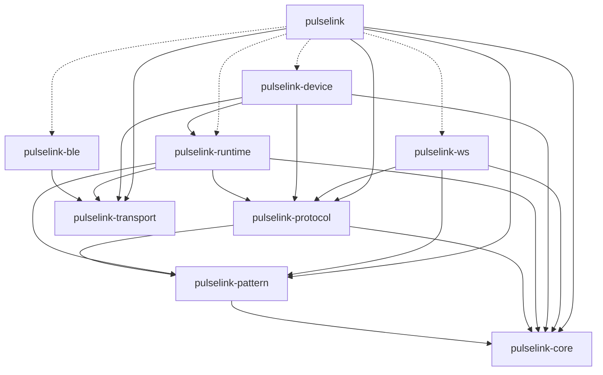

# Architecture

`pulselink-rs` is the Rust workspace for `pulselink`. It contains nine library crates and one
non-published integration-test package. The full task breakdown is in
[`ROADMAP.md`](ROADMAP.md).

## Crate graph

## Boundaries

- `pulselink-core` is small, synchronous, and has no I/O.
- `pulselink-pattern` owns semantic waveform time, not wire bytes.
- `pulselink-protocol` is sans-io: no Tokio, no btleplug, no WebSocket.
- `pulselink-transport` is the local-device port. It has no Tokio or btleplug dependency. It is not
  a universal network transport; WebSocket is separate.
- `pulselink-ble` is an adapter. It implements transport traits and keeps btleplug types out of the
  public API.
- `pulselink-runtime` owns Coyote V3 sessions, ACK, scheduling, safety, and reconnection. It
  depends on transport, not btleplug.
- `pulselink-device` owns local drivers for Coyote V2, PawPrints, Civet, and Opossum. It wraps the
  Coyote V3 runtime rather than reimplementing it.
- `pulselink-ws` owns V4 RPC, multi-app state, typed remote-device snapshots, and remote operations.
  It does not depend on BLE or the runtime.
- `pulselink` is the composition root and facade. It must not contain a second implementation of
  session logic.

## Dependency rules

1. Lower crates never depend on higher crates.
2. `core`, `pattern`, `protocol`, and `transport` do not depend on any other workspace crate (except
   the arrows above).
3. `runtime` must not depend on `pulselink-ble`.
4. `ws` must not depend on `pulselink-runtime`, `pulselink-ble`, or
   `pulselink-transport`.
5. The facade re-exports curated APIs; it does not use wildcard re-exports at the crate root.

## Why these crates

- `transport` is a port that runtime already needs. It is not speculative; it keeps the high-level
  runtime independent of platform BLE code.
- A separate `pulselink-device` crate is deferred until a second device with a different control
  model exists. With one Coyote V3 driver, a universal driver trait would be premature.
- A separate WebSocket protocol crate is deferred. `pulselink-protocol` uses feature flags
  (`coyote-v3`, `socket-v4`) so BLE-only users do not compile JSON/RPC dependencies.
