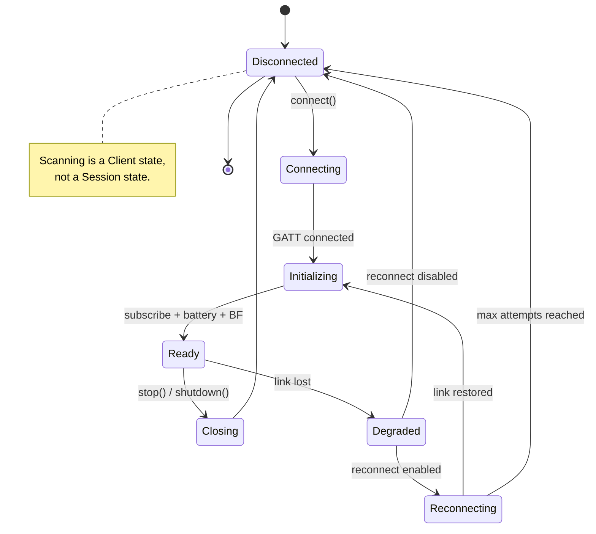

# Runtime contracts

This document summarizes the behavioral rules for `pulselink-runtime`. The full design is in
[`ROADMAP.md`](ROADMAP.md).

## State machine

`Connected` and `Ready` are not the same: GATT connected does not imply Notify subscription or BF
initialization.

## Initialization

1. Connect GATT.
2. Discover services/characteristics.
3. Verify write/notify properties.
4. Subscribe to `0x150B` and `0x1500`.
5. Read battery.
6. Write BF.
7. Enter `Ready`.

BF has no response. Record only that the write was accepted by the transport.

## Sequence/ACK

- B0 sequence 0 means no B1 is required.
- Intensity changes use sequence 1..=15.
- Only one intensity request may be pending per device; later requests queue.
- B0 waveform frames continue while waiting for ACK.
- Matching B1 completes the request and updates observed intensity.
- Sequence 0 B1 updates observed state without completing the request.
- Mismatched B1 updates observed state but does not complete the request.
- Timeout marks intensity unknown and returns an error. Do not automatically retry relative changes.

## Scheduler

- 100 ms tick, monotonic clock, `MissedTickBehavior::Skip`.
- Select the frame from elapsed time, not `index += 1`.
- Do not queue stale frames.
- If the scheduler falls behind beyond the configured threshold, pause output, send silence, and
  emit a lag event.
- Stop/clear has priority over waveform frames.

## Safety and shutdown

- `SafetyPolicy` is independent of device BF soft limits.
- `stop()` stops the scheduler, cancels pending operations, sends an absolute zero-intensity B0, and
  waits for B1 with a timeout.
- `shutdown().await` is explicit. `Drop` must not perform async BLE work.
- Reconnect must not automatically resume patterns or output.
- If the link is down, software stop is best-effort only.
