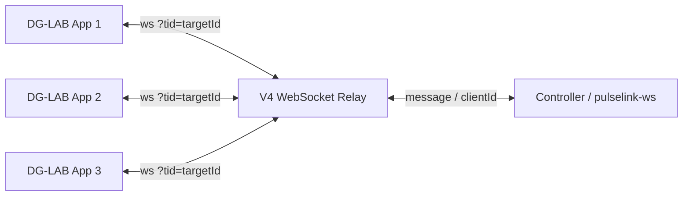

# DG-LAB V4 WebSocket protocol

This is a working summary for `pulselink`. It is not a copy of the official documentation.

## Topology



- The controller connects first and receives `hello { clientId }`.
- The controller's `clientId` is called `targetId` when pairing an app.
- Apps connect with `?tid=<targetId>`.
- One controller can have multiple app clients.
- Device operations need both `clientId` and `slotId`.

## Outer frames

`hello`, `client_attached`, `client_disconnected`, `controller_attached`,
`controller_disconnected`, `heartbeat`, `pong`, `message`, `idle_timeout`,
`error`.

Controller-to-app message:

```json
{
  "type": "message",
  "clientId": "<app>",
  "data": {}
}
```

## Inner RPC

```json
{
  "t": "req",
  "reqId": "req-1",
  "m": "devices.get",
  "data": {}
}
{
  "t": "resp",
  "reqId": "req-1",
  "result": {}
}
{
  "t": "resp",
  "reqId": "req-1",
  "error": "slot_not_found"
}
{
  "t": "ev",
  "ev": "devices.snapshot",
  "devices": []
}
```

`reqId` must be unique among pending requests for the same app client.

## Methods

| Method            | Purpose                        |
|-------------------|--------------------------------|
| `devices.get`     | Request the app's device list  |
| `ping`            | App-level round-trip probe     |
| `device.op`       | Submit a device operation task |
| `device.op.clear` | Clear all/device/channel tasks |

## Device operations

| `t` | Type             | Lifecycle                                      |
|----:|------------------|------------------------------------------------|
|   0 | AppendPulseData  | Continuous; completes when frames are consumed |
|   3 | AddIntensity     | One-shot; `v` may be negative                  |
|   4 | SetTempIntensity | Continuous; resets to 0 when the task ends     |
|   7 | SetIntensity     | One-shot; only `v = 0` is accepted             |

`device.op` responds when the task completes, is cleared, replaced, or cancelled, not when it is
queued. `device.op.clear` returns `{}` immediately; each cleared task also receives its own
`device.op` response with
`reason: "cleared"`.

## Events and cache

- `devices.snapshot` replaces the device list.
- `devices.patch.added/removed` updates it.
- `slots.patch` deep-merges `props`/`slotState` by `slotId`.
- `custom.action` carries an integer `0..=9`.
- Keep unknown fields; do not deserialize into a closed struct.

## Reconnect

A new controller connection gets a new `clientId`. The app must re-pair with the new `targetId`. Do
not silently reuse an old pairing ID.

## Reference

<https://github.com/dungeonlab-open/dglab-kit>

<https://github.com/dungeonlab-open/dglab-websocket-server>
